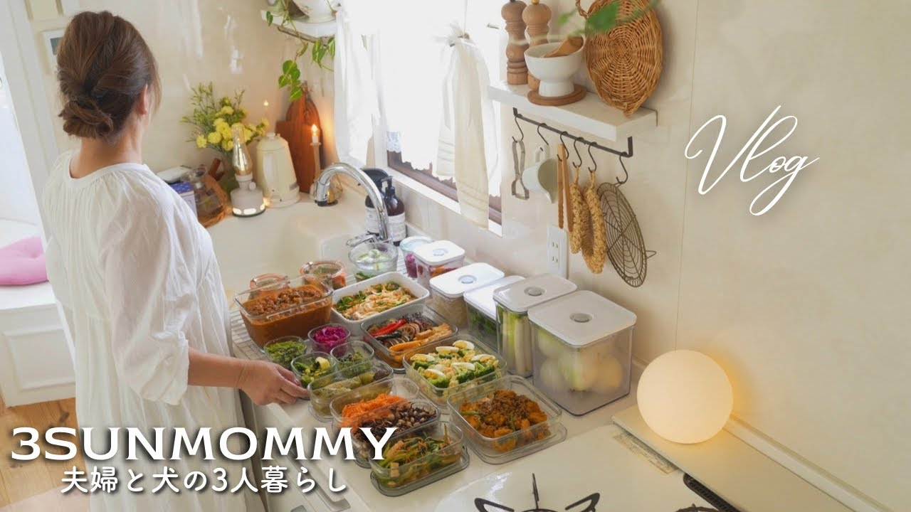

# 【作り置き18品】1週間をラクにする簡単レシピ | 夏野菜を使った家庭料理 | 下ごしらえと冷凍ストック

- 調べた日：2026-10-12（数字はいちばん新しい日の時点）
- チャンネル：3SUNMOMMY 夫婦と犬の3人暮らし（@3sunmommy、登録者 13,000人）
- 公開日：2026-08-21　長さ：35分09秒　形：横長
- 再生：215,756回（登録者の 16.6倍）　高評価：1,245　コメント：62
- URL：https://www.youtube.com/watch?v=ALtVVxSU2o8

## サムネ

## 人気のコメント（いいねの多い順・上から10個）

1. （いいね 7）本当に素晴らしい〜 作りおき〜 真空で長持ち保存が可能なんですよね〜 試してみよー 長い目で見たら、野菜を無駄にせずですよね🎉  ありがとうございました♪
2. （いいね 6）初めまして。 真空保存容器を検討していて、カインズの安いのにしようか迷っていました。バクエン、やっぱりよさそうですね。ツヴィリングとも迷うのですが…
3. （いいね 5）素晴らしい👏👏私も作り置きしますが、5品ぐらいまでです😅腰痛があり長時間立ちっぱなしは禁止❌️🤣🤣今回は詳しくレシピや作り方載せていただき嬉しいです😊有難うございます✨
4. （いいね 5）初めまして！私もバクエン容器使い始めました。やっぱり下に敷くものがあった方がお野菜は痛みづらいですか？お水の音、氷のカラカラする音、、可愛いわんちゃん、すごく癒されました。そしてとてもお料理上手ですね❤
5. （いいね 4）日々の献立を手早くしたいと思いYouTube見てます。 何の白だしを使ってますか教えて下さい。
6. （いいね 3）旦那さんも優しそうでいい家族😊
7. （いいね 3）初めて拝見させていただきました お料理が凄く綺麗で栄養満点ですね 家族もとても素敵ですね 次回楽しみにしております
8. （いいね 3）お疲れさまです。 サンちゃんに いつも癒されてます🍀 作り置き凄く参考になりました。保存容器やはりいいですね。購入したいなぁー😊
9. （いいね 2）初見です😊家族の「美味しい」の一言で心が満たされますよね♡ 家族を想って費やした時間が、豊かなひとときにつながっていて素敵でした✨
10. （いいね 2）初めてコメントさせて頂きました ルームツアーやお料理の動画見させて頂いて　素敵💓な生活💓されてますね✨✨✨✨✨ お料理の作り置き　参考にさせて頂きます

## メモ（なぜ伸びた？ 視聴者は何を求めている？）

- 
