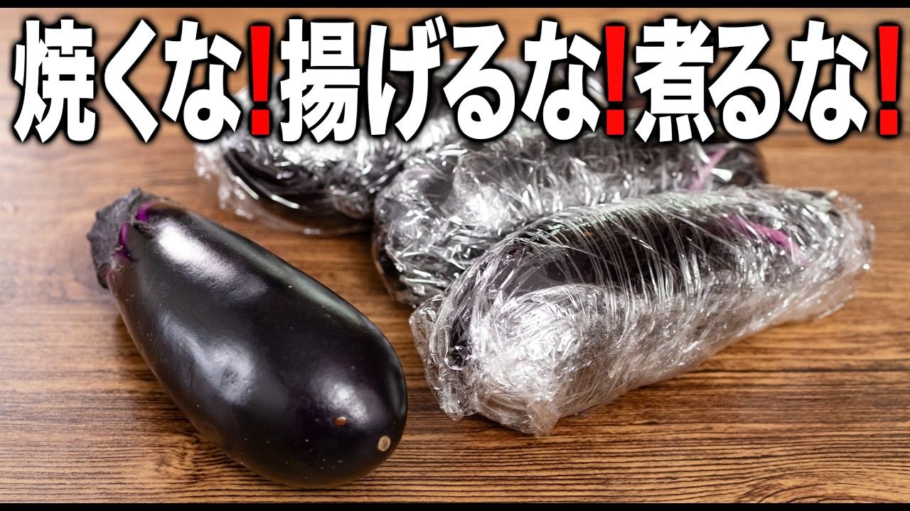

# 【焼かない】【揚げない】【煮ない】ご飯が鬼ほどすすむ茄子レシピ

- 調べた日：2026-10-12（数字はいちばん新しい日の時点）
- チャンネル：Aosトラットリア〜青池のオッティモな食卓（@aos、登録者 435,000人）
- 公開日：2026-08-09　長さ：13分51秒　形：横長
- 再生：661,329回（登録者の 1.5倍）　高評価：4,516　コメント：76
- URL：https://www.youtube.com/watch?v=IAOmNiWvb34

## サムネ

## 人気のコメント（いいねの多い順・上から10個）

1. （いいね 27）レンチンしたナスはラップのまま凍った保冷剤を当てて冷ますとゴミや洗い物も出ずおすすめです
2. （いいね 14）ナスは火の通し方が難しいですよね。 料理がそれほど得意ではない 家庭の主婦の一員の私など 油で炒めては、油ギトギトになるし💦😭 油なしでやろうとすると 今度はフライパンに貼りついてしまうし 炒めたり焼いたりせずに ナスが美味しく食べれるとなれば 特売の大袋を買っても ご近所の家庭菜園から大量に頂いても 怖いものがなくなりますね😂🍆✌️💕︎
3. （いいね 10）美味しそう！富山出身なので富山弁丸出しの料理動画おもしろい！
4. （いいね 8）おいしそう！！！すぐつくる！
5. （いいね 8）イタリアンヴァージョンですが、これにゼラチンや寒天を使って、フレンチの「野菜のプレッセ」風にするのはありでしょうか。パイレックスにプロシュートを敷いてやって包んでやったらいけそうな気がするんですがダメでしょうか。
6. （いいね 7）味噌だれでも風味出ますね。いろいろなバリエーションがあってまさに万能の茄子ですね。
7. （いいね 7）初見です。 「何か富山弁ぽい」と思って調べたら、富山出身でしたか。同郷で親近感。
8. （いいね 7）漬けている間に使っているタッパーはどこのですかー？ガラス？アクリル？
9. （いいね 6）茄子の剥き方なんですが、頭の方を包丁で十字に切れ込みを入れて割くと剥きやすいてす。
10. （いいね 5）和風のを作ってみました。めちゃくちゃ美味しかったです❤ナスレンチンいいですね！油はタレに入るオリーブオイルだけなので、ほんとにヘルシー美味しい🎉揚げ浸し卒業します！これからはこの方法、タレでいきます宣言‼️🤩

## メモ（なぜ伸びた？ 視聴者は何を求めている？）

（2026-10-14 記入）
- なぜ伸びた：「焼かない・揚げない・煮ない」の3つの「ない」。サムネ「焼くな！揚げるな！煮るな！」の命令口調
- 視聴者が求めている：茄子の火の通し方の失敗をなくしたい（油ギトギトになる）、ご飯がすすむおかず
- 使える要素：失敗しやすい調理を「しない」で解決する
