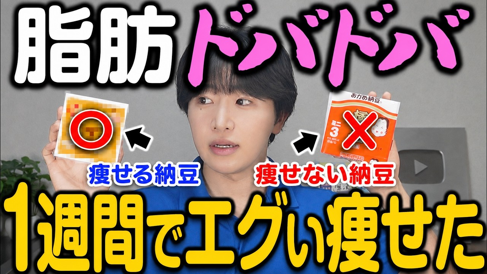

# 【納豆に〇〇を混ぜるだけ】宿便がドバッと出てお腹が勝手に凹む！最強の納豆ダイエットTOP5※第1位は意外すぎた

- 調べた日：2026-10-12（数字はいちばん新しい日の時点）
- チャンネル：たくみ先生 | 40代からの食べやせ教室（@biyou_takumi、登録者 196,000人）
- 公開日：2026-08-27　長さ：16分36秒　形：横長
- 再生：643,613回（登録者の 3.3倍）　高評価：2,443　コメント：188
- URL：https://www.youtube.com/watch?v=lJaiKrlASTU

## サムネ

## 人気のコメント（いいねの多い順・上から10個）

1. （いいね 31）乾物は「かんぶつ」です❤
2. （いいね 24）キムチ納豆好んでましたが、中国産の白菜がホルマリン漬けという記事を見て韓国で作られていたとしても韓国も中国からの輸入と聞きキムチを食べるということの敷居が高くなってしまいました。 しかし、酢納豆も好きだし、おからや切り干しも気になるので是非明日試してみます❤
3. （いいね 20）好きなように食うのが一番や
4. （いいね 14）韓国政府と韓国産は 信用していないので キムチくんマークのものは絶対買いません。 取り敢えず国産白菜使ってないと 買いたくないですな。  オートミールと切り干し大根は 参考にさせて頂きます。 二つともダイエット食品なのは 知ってたけど、使い方のアイデアが イマイチ浮かばなかったので 納豆に混ぜてみます。 今は、納豆にオクラとめかぶとキムチを 入れてリンゴ酢、ご飯なしで 食べてましたが これに切り干し大根とオートミールを 混ぜてみるわ。
5. （いいね 8）ケンミンshowでまさに納豆＆切り干し大根が特集されてましたよ！茨城ケンミンも茨城県知事も推してました。美味しそうですね。
6. （いいね 7）たくみ先生のヨーグルトにおからパウダーを混ぜるダイエットをしています！ なのでおからパウダーをいっぱい買ったので、先ずは納豆におからパウダーで試してみます！
7. （いいね 6）納豆+○○はダイエットのためには3ヶ月以上とかではなくて、ずーっと続けた方がいいですよね。
8. （いいね 6）切り干し大根は軽く洗った方がいいですよ
9. （いいね 5）最後まで見てくださってありがとうございます！  動画で紹介した5つを「どの順番で・どれくらい・いつ食べるか」を 1冊にまとめた特典を無料でお配りしています🎁  『混ぜるだけでお腹が凹む！最強納豆ダイエットBOOK』  ▼ 受け取り方（30秒で終わります） ① 下のリンクから、僕の公式LINEを友だち追加 　 https://tabeyase.takumi-diet.com/line/open/EoMYeQpEtjeD?mtid=TA7o6tmscSFP ② トーク画面で、ひらがな4文字で「なっとう」と送る  すでに友だち追加してくださっている方も、「なっとう」と送るだけで受け取れます😊  ━━━━━━━━━━━━━━  ▼ コメントで多かったご質問にもお答えします！  ・朝じゃなくて夜でもいい？ → 大丈夫です！腸がいちばん働くのは寝ているあいだなので、夜に入れたものが翌朝のお通じをつくります  ・たれは入れちゃダメ？ → 入れてOKです！ただ半分にしておくと塩分が積み上がりません。ごま油を数滴たらすと物足りなくならないですよ  ・毎朝食べてるオートミールはカットすべき？ → カット不要です。ご飯も減らさないでください！置き換えではなく、ちょい足しでいきましょう  ・めかぶ、もずく、ひじきでもいい？ → もちろんです！お腹が張りやすい方には、むしろこちらがおすすめです  ・お酢はリンゴ酢じゃなきゃダメ？ → 米酢でも穀物酢でも大丈夫です  ※もっと詳しい答えは、全部この特典BOOKに書いてあります  ━━━━━━━━━━━━━━  最後に、みなさんに聞きたいです👇 【5つのうち、最初に試すならどれですか？】 コメントで教えてもらえたら、全部読みにいきます！
10. （いいね 4）おからパウダーは意外だった😮 元々リンゴ酢で納豆を食べていたので、お水ではなく、おからパウダーをリンゴ酢でふやかして食べてみようと思います。

## メモ（なぜ伸びた？ 視聴者は何を求めている？）

（2026-10-14 記入）
- なぜ伸びた：「宿便がドバッと出て、お腹が勝手に凹む」の強い言葉と、TOP5のランキング
- 視聴者が求めている：痩せたい・お腹を凹ませたい
- 使える要素：ランキング形式。ただし体への効果を強く言い切るのは、根拠がないと危ない（まねしない）
