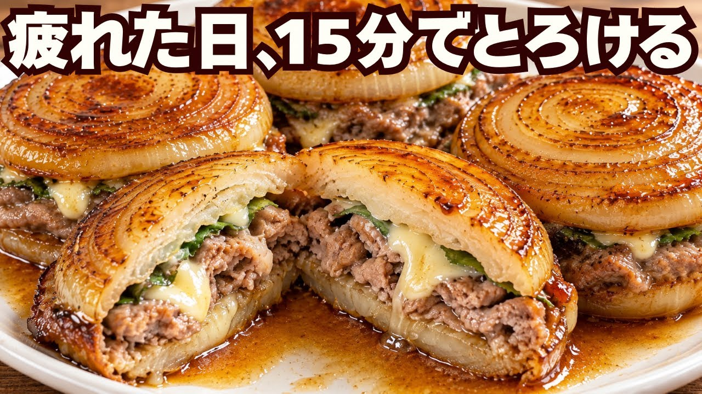

# 乗せて焼くだけ！豚こまがジューシーな玉ねぎチーズ挟み焼き

- 調べた日：2026-10-12（数字はいちばん新しい日の時点）
- チャンネル：簡単レシピ🤍東京OLむむちゃん（@channel_mumumu、登録者 91,600人）
- 公開日：2026-10-01　長さ：8分23秒　形：横長
- 再生：1,803,578回（登録者の 19.7倍）　高評価：9,476　コメント：304
- URL：https://www.youtube.com/watch?v=jc0wvkIaeI4

## サムネ

## 人気のコメント（いいねの多い順・上から10個）

1. （いいね 91）私がやったら絶対玉ねぎがバラける自信ある
2. （いいね 91）2〜3センチ幅ってとても分厚いけど合ってます？
3. （いいね 66）包丁のゆびこわい😭
4. （いいね 44）実際作ってみましたがお手軽な割にかなり食べ応えあって良いですね。味変にブラックペッパーも合うのでオススメ。
5. （いいね 24）豚こま、すぐ炒めちゃうので斬新レシピです❤😊
6. （いいね 20）美味しそう🤤 こりゃ作らないと！
7. （いいね 13）これはいい！作ってみます。
8. （いいね 13）サムネのＡＩ画像が 本当、世間で言われてると同じ 【ＡＩは食欲が失せる】そのもの
9. （いいね 12）レンコン挟み焼きは、有るけど玉葱挟みも😊良いですね〜。疲れてるのに、手間かけて作られてるの本当にスゴい。
10. （いいね 12）ミンチ肉で作っても食べやすく美味しく作れそうですね👍

## メモ（なぜ伸びた？ 視聴者は何を求めている？）

- 
