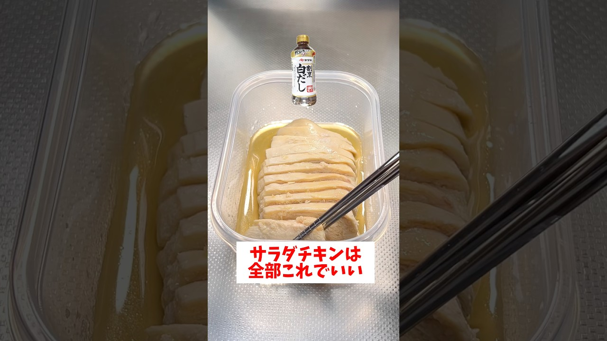

# 【レンジで簡単】【しっとりサラダチキン】白だしを使って誰でも簡単にしっとりとしてて超美味しく仕上がる！#short#節約レシピ#料理

- 調べた日：2026-10-12（数字はいちばん新しい日の時点）
- チャンネル：お任せCOOK（@cook3239、登録者 118,000人）
- 公開日：2026-09-06　長さ：1分03秒　形：ショート（縦長）
- 再生：3,044,444回（登録者の 25.8倍）　高評価：42,078　コメント：262
- URL：https://www.youtube.com/watch?v=iiFs7sRcACc

## サムネ

## 人気のコメント（いいねの多い順・上から10個）

1. （いいね 460）生姜チューブ3m(メートル)でワロタ
2. （いいね 181）これまで見た中で、一番簡単な作り方❗ やっぱ、ヤマキの白だしが一番美味しく感じます😋
3. （いいね 176）(材料) 鶏むね肉（1枚）、240g 好みの白だし、大さじ3 料理酒、大さじ1 水、大さじ1  (作り方) ①タッパー(680mℓ)に鶏胸肉を入れ両面をフォークで刺して穴を開け、調味料を全て入れ両面にしっかり馴染ませる  ②ふたを斜めに置き600w2分(500w2分30秒)温めて取り出し、肉を裏返て再び600w2分(500w2分30秒)温めたら完成です！  ※温めた後は熱いので粗熱をとり食べやすい大きさにカットします  ※レンジの時間はあくまでも目安で肉の大きさによってレンジの時間は変動します🙇
4. （いいね 100）字幕の生姜が【3m】でちょっと吹いたwww
5. （いいね 64）酒を臭み取りで使うなら先に入れるべし。 しっとり感を出すならこのままラップを浮かないようにかけて冷ますとよりしっとり。
6. （いいね 45）一時期サラダチキン造りにハマってたな。 パスタゆでたあとのお湯に塩だけで味つけしてジップロックで低温調理。
7. （いいね 37）ヤマキの白だしが一番美味しい😋
8. （いいね 36）うちはず〰️っと七福の白だし‼️あれこれ試したけど、やっぱり七福👍 鶏むね、作ってみるわ🐓
9. （いいね 35）この残ったたれに梅干し叩いてお酢も混ぜてかけたらすっぱさっぱりお酒のおつまみ！
10. （いいね 33）よだきい作業なく 大分県の方ですか？ いい言葉ですね～😊

## メモ（なぜ伸びた？ 視聴者は何を求めている？）

- 
