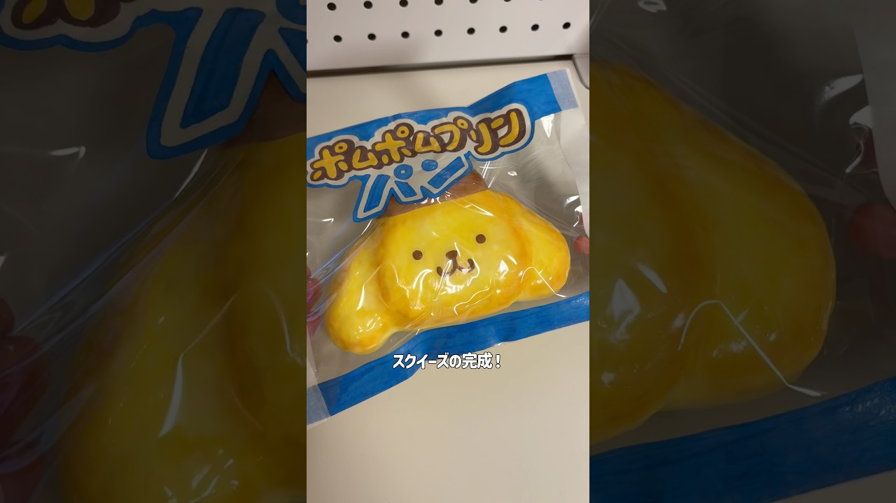

# 超簡単なスクイーズの作り方！ #diy #ハンドメイド #100均diy #squishy

- 調べた日：2026-10-12（数字はいちばん新しい日の時点）
- チャンネル：しゃこ Shaco Studio（@diyshaco、登録者 124,000人）
- 公開日：2026-07-28　長さ：1分31秒　形：ショート（縦長）
- 再生：6,723,374回（登録者の 54.2倍）　高評価：106,058　コメント：1,226
- URL：https://www.youtube.com/watch?v=Ay8Cc5O8mP4

## サムネ

## 人気のコメント（いいねの多い順・上から10個）

1. （いいね 23,276）「整えてたらスポンジ無くなりました、、、」←これマジ好きw
2. （いいね 17,542）ここまで説明してくれてるのに まだ出来ないやつはもう諦めた方が早い
3. （いいね 7,693）一緒に作るためにわざわざスピードを落としてくれる神…見捨てないでくれてありがとう………
4. （いいね 4,983）こんなに説明動画出してくれるの神だろ
5. （いいね 4,838）みんな文句たれまくってんじゃなくて作ろうよ！！！！！ やってみたら無理でした 私ごときがほざいてごめんなさい スポンジのサイズがアリになりました🐜 みんな頑張って作ろうね😭😭😭😭
6. （いいね 3,442）投稿主が上手すぎるという褒め言葉を、自虐ネタも込めて｢一緒にやろうって言ったじゃん｣とか｢気づいたらスポンジが消えてた｣とか言うのは最初は面白いんだけど、しつこく擦るとダルいしコツを見てもなお出来ないって人は練習しなよって思う short動画のコメ欄って自分で試してみるとか練習するとかの概念がない人が多すぎる
7. （いいね 2,229）安定の下書きのうまさ
8. （いいね 1,800）ここまで説明してくれてるのにまだ置いてかれるとか言ってる人が居るの意味不明 時間かけてちまちま切ってみなよ
9. （いいね 575）つくる前→おっし！わかるぞ！ 作った後→ゴミ爆誕☆
10. （いいね 573）とにかく真似しながら何度も作ってれば上手くなっていくから私には出来ない～、分からない～じゃなくて作ればいいのに。こんなに丁寧に教えてくれてるんだから

## メモ（なぜ伸びた？ 視聴者は何を求めている？）

- 
