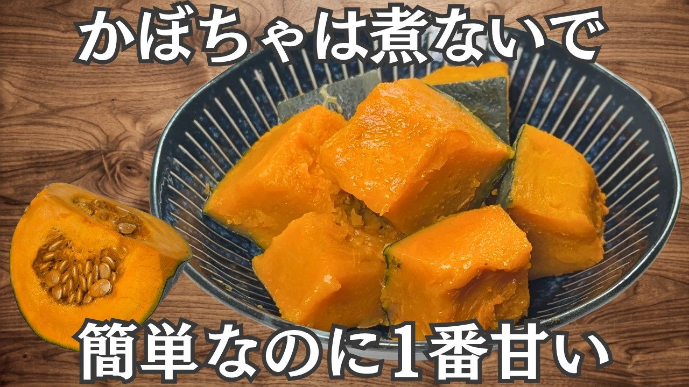

# 超簡単【塩かぼちゃ】煮るより甘くてホクホク♪むくみ解消・かぼちゃ大量消費・作り置き・常備菜

- 調べた日：2026-10-12（数字はいちばん新しい日の時点）
- チャンネル：副菜おたすけキッチン（@fukusai__kitchen、登録者 1,720人）
- 公開日：2026-09-17　長さ：2分07秒　形：横長
- 再生：476,232回（登録者の 276.9倍）　高評価：916　コメント：9
- URL：https://www.youtube.com/watch?v=yLp9k0rtsEw

## サムネ

## 人気のコメント（いいねの多い順・上から10個）

1. （いいね 7）わたしはカボチャが大好きです。煮たのより、焼いたのが好きです。レンチンして火が通ったら、塩を振ってフライパンで焼き色が付くまで焼きます。ただそれだけの味付けですが、カボチャの他に、玉ねぎ、ジャガイモ等の根菜は、この手口(笑)で食べたいんです。 でも次カボチャ買って来たら、コレやってみます♪
2. （いいね 7）レンチン時、かぼちゃに水と塩を入れキッチンペーパーをぬらしてかけます その上に落としラップをして、更に普通にラップするとレンチンでもパサパサしません😊 水は、蒸した状態にする為 塩は甘みを引きたたせる為に入れます さつま芋も、同じです 水にさらした後😊 お菓子にも活用しやすくなります 違う仕方、かぼちゃはカット前にワタをとりラップをして4〜5分レンチンするとカットしやすくなります😊
3. （いいね 3）かぼちゃ🎃のそのままのお味！  好きです🍂秋ですね
4. （いいね 3）塩無しでしてました 塩ありでしてみます😊
5. （いいね 2）柔らかくした、かぼちゃ🎃をバター＆塩で焼くと美味しいです😊
6. （いいね 2）塩いらない
7. （いいね 0）電気圧力鍋の圧力調理で５分ほど蒸しています。水気は少なくなりますが、その分ホクホクした食感になります。南瓜の種は乾燥させて味付けなしでそのまま食べています。歯応え抜群で空腹感を紛らわせるのに効果的です。最近は種欲しさに南瓜を食べることもあります。

## メモ（なぜ伸びた？ 視聴者は何を求めている？）

- 
