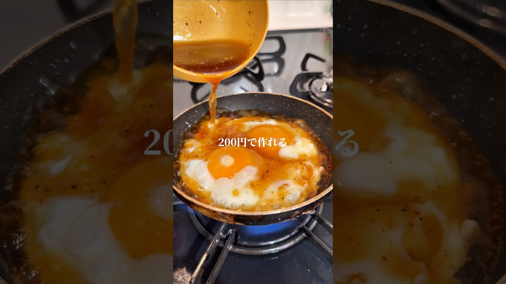

# 朝ごはんに最適！200円で作れる半熟と玉丼🥚🍚朝ごはん朝食卵レシピたまご料理節約レシピ

- 調べた日：2026-10-12（数字はいちばん新しい日の時点）
- チャンネル：guhucm（@guhucm_ojcz、登録者 25,400人）
- 公開日：2026-09-09　長さ：1分01秒　形：ショート（縦長）
- 再生：2,937,515回（登録者の 115.7倍）　高評価：35,795　コメント：494
- URL：https://www.youtube.com/watch?v=wGqfgJkfdhU

## サムネ

## 人気のコメント（いいねの多い順・上から10個）

1. （いいね 1,041）油は「裏カリカリになったら」のタイミングでペーパーで吸った方がよさそうですね！ もうこういうの重たい歳なので野菜と肉足して真似したいです
2. （いいね 805）サムネの『半熟と玉丼』て何だろと覗いたら油の海だった💧
3. （いいね 590）ニンニクの量が秒単位なのが斬新
4. （いいね 337）油多くね？
5. （いいね 293）卵焼くのをごま油で焼いてタレには油なしでも良さそう
6. （いいね 146）美味しいとは思うけど、目玉焼きにしては調味料がめんどい　そこまでやるなら普通に料理する  焼き肉のたれでちょびっと煮込む感じでやれば似たような味になると思う　そんなんで十分
7. （いいね 145）朝ごはんじゃなくて土曜の昼飯だな
8. （いいね 120）フライパンに入れるサラダ油だけでも多いのにタレにもごま油💦あと調味料が多いので塩分も凄い😅 30代以上は胃もたれ確実コースだなぁ ※初めて沢山の高評価押して頂いてビックリしたので追記。共感して頂いた皆様、ありがとうございます。
9. （いいね 115）🧄いれてて朝ごはんに最適！は、なかなか疑問w
10. （いいね 88）油使いすぎ😮

## メモ（なぜ伸びた？ 視聴者は何を求めている？）

- 
