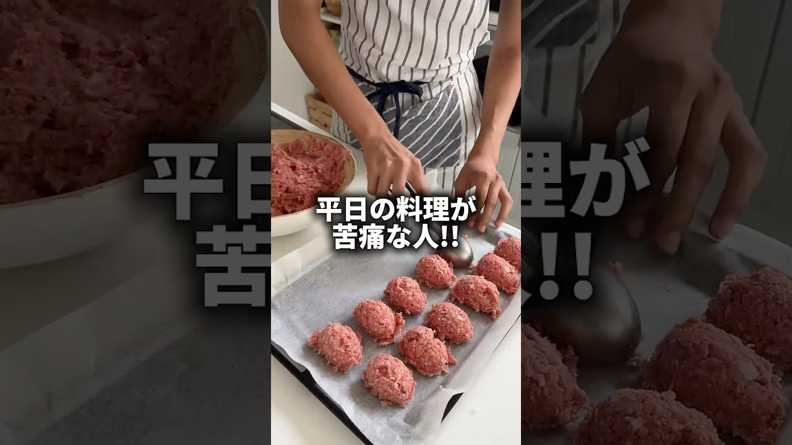

# 平日本気で料理するのが嫌な人の為の時短ひき肉ストック🙂‍↕️✨#簡単レシピ #自炊 #2人暮らし #料理 #夜ごはん

- 調べた日：2026-10-12（数字はいちばん新しい日の時点）
- チャンネル：Hanaの暮らし（@hanacookinglife、登録者 465,000人）
- 公開日：2026-08-20　長さ：1分18秒　形：ショート（縦長）
- 再生：4,361,149回（登録者の 9.4倍）　高評価：90,426　コメント：773
- URL：https://www.youtube.com/watch?v=Ee85wEGXO3M

## サムネ

## 人気のコメント（いいねの多い順・上から10個）

1. （いいね 5,804）平日も嫌だけど 週末に仕込むのもめんどくさいのよ～ やれる人尊敬する
2. （いいね 1,882）二キロのひき肉…一般家庭はこんなに色々作れるんだ…うちは二キロのひき肉は全てハンバーグで１食で消えてしまう…
3. （いいね 709）すごい……！一気にハードル下がった気がします！ 早速真似させてもらいます💪
4. （いいね 639）その肉だねを使って結局毎日なんだかんだ料理するわけだから、週末に挽き肉を仕込むという仕事が増えるだけに感じる。私の場合だけど。
5. （いいね 588）これは、すぐ真似したい😊
6. （いいね 290）天才です！鶏むねや豚こまなどでシリーズ化希望です❤
7. （いいね 241）天才やん....っ！！
8. （いいね 236）そうか、ディッシャーである程度形を作ればいいのか！とこの動画を昨日見て今日買ってきましたw
9. （いいね 214）作り置きのために一気に大量に作るのすらめんどいからきっと真似はできないけど、ひき肉活用レシピとしてはめちゃくちゃありがたい動画
10. （いいね 177）作り置きしたいけど何個も丸めたりするのめんどくさいし大きさもバラバラになっちゃうのでディッシャーは目から鱗でした🥺✨ ディッシャー買ってやってみます！ 動画のディッシャー欲しくて探してたら「レモン型ディッシャー」で出てきましたー✨

## メモ（なぜ伸びた？ 視聴者は何を求めている？）

- 
