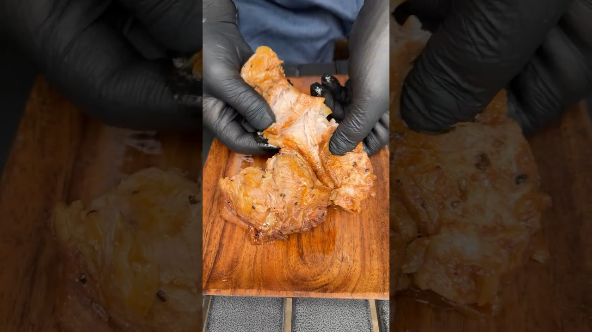

# 絶品プルドポークの時短レシピを紹介します！

- 調べた日：2026-10-12（数字はいちばん新しい日の時点）
- チャンネル：ひみつ基地。（@himitsu-kichi、登録者 1,850,000人）
- 公開日：2026-08-23　長さ：1分15秒　形：ショート（縦長）
- 再生：3,049,349回（登録者の 1.6倍）　高評価：63,467　コメント：269
- URL：https://www.youtube.com/watch?v=WbPr7jaZZkw

## サムネ

## 人気のコメント（いいねの多い順・上から10個）

1. （いいね 1,301）プルドポークずっと憧れてて、でも再現は無理そうだなって思ってたからめちゃめちゃ嬉しいです！！！ありがとう！！この動画に巡り会えてよかった！！！
2. （いいね 793）炊飯器に米粒残ってるのかと思った😂
3. （いいね 159）※なおその後の炊飯器
4. （いいね 154）仕事がめちゃくちゃ忙しくてしんどいので、明日は残業終わりに材料買ってこれ作ります! 暑さにも仕事にも負けない!
5. （いいね 153）炊飯器は火の通りが間違いないので簡単でいいですね。
6. （いいね 146）洋風豚角煮、美味しそう😊
7. （いいね 122）なんだよ、ただの天才的な動画かよ。 見て得した。
8. （いいね 40）作りたい！！！ 詳しい分量知りたいなあ！！！
9. （いいね 26）詳細なレシピをお願いしたい·····作りた過ぎる
10. （いいね 22）料理が上手でいつも見てるとお腹が減りますね😊

## メモ（なぜ伸びた？ 視聴者は何を求めている？）

- 
