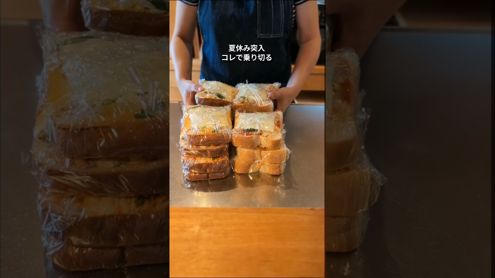

# 40代子育て主婦│夏休みの朝食作り置き│簡単レシピで時短家事で楽をする│食パンでピザトースト #ママ #作り置き #朝食 #ピザ #パン

- 調べた日：2026-10-12（数字はいちばん新しい日の時点）
- チャンネル：hiraya2015（@hiraya2015、登録者 73,000人）
- 公開日：2026-07-17　長さ：1分06秒　形：ショート（縦長）
- 再生：957,694回（登録者の 13.1倍）　高評価：6,014　コメント：213
- URL：https://www.youtube.com/watch?v=9KVfaQS10Ko

## サムネ

## 人気のコメント（いいねの多い順・上から10個）

1. （いいね 268）焦げてる😂
2. （いいね 225）本当にお母さんの努力ですよね お疲れ様です
3. （いいね 222）おにぎりとかピザトーストを朝食の作り置きのつもりで作っておくと「お腹すいたー！」って瞬殺される😂
4. （いいね 109）母って偉大だなぁ
5. （いいね 95）恐怖の夏休み思い出す🌻 昔は作り置きって言う考えがなかったから 毎回作ってた！後はカップ麺とか😅 手際の良さに感激しました😊😊😊
6. （いいね 62）おおっ！！凄い！お腹空いたら何時でも食べれますね！
7. （いいね 30）仕込み上手ですね🌸
8. （いいね 27）焦げすぎて草
9. （いいね 24）尊敬しかない😂 愛だね、愛❤ 羨ましいわ
10. （いいね 23）こういうの見るとホント世のお母さん達毎日大変だよな…って思う。ゆっくり休む時間もないだろうに。 子どもの頃ご飯作ってくれた母に感謝したい🙏

## メモ（なぜ伸びた？ 視聴者は何を求めている？）

- 
