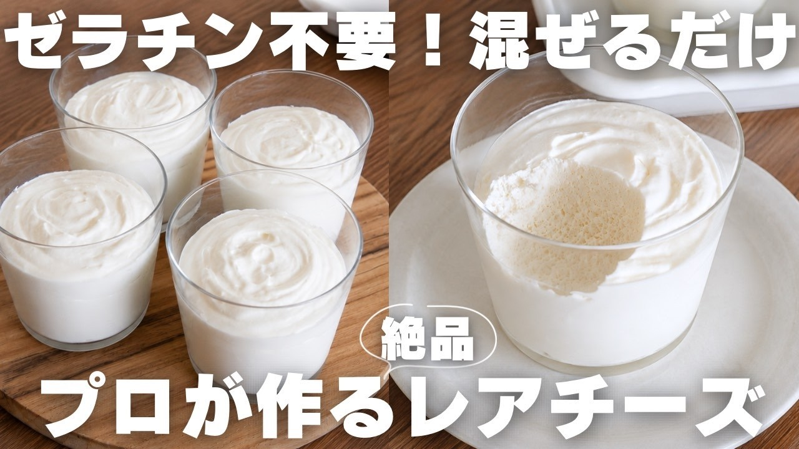

# 【材料３つ】混ぜるだけ！とろける濃厚レアチーズケーキ

- 調べた日：2026-10-12（数字はいちばん新しい日の時点）
- チャンネル：HIRO SWEETS （@hiro_sweets、登録者 375,000人）
- 公開日：2026-08-22　長さ：8分02秒　形：横長
- 再生：1,155,525回（登録者の 3.1倍）　高評価：9,886　コメント：87
- URL：https://www.youtube.com/watch?v=AN9hhWqzUYQ

## サムネ

## 人気のコメント（いいねの多い順・上から10個）

1. （いいね 83）これ、冷凍したらアイスクリームになりますかね〜？
2. （いいね 53）少し塩気のあるクッキー溶かしバター混ぜたのをカップの底に入れても美味しそうだー！
3. （いいね 31）ラップをする発想なかった、、、いつもめちゃ飛んで困っていた
4. （いいね 30）早速作りました。口当たりよく滑らかでほんのり酸味もありメチャメチャ美味しかったです。両親にも好評でしたよ！ いつも動画楽しみにしております。 美味しいレシピありがとうございました。
5. （いいね 23）余すことなくやってるところが素敵過ぎるー！❤
6. （いいね 17）作りました‼️材料も少ないし美味しいし、リピします😊
7. （いいね 15）型が無くても出来て便利！これは作りたい。
8. （いいね 14）作りましたー！もう2回も🤭 フルーツ乗せて食べると絶品❤ 最近ヒロさんのスイーツしか作っていません😂 いつもありがとうございます✨
9. （いいね 10）作ってみました。ちょっとムースみたいな感じで美味しかったです。 クリームチーズの消費期限が近付いているのに忙しくてどうしようかと思っていたら、本当にちょうど良い時に！これは気軽にできるし、美味しいし、言うこと無しです。すてきなレシピをありがとうございます。
10. （いいね 9）以前紹介された「ゼラチンを使わないレアチーズケーキ」を作りました。これは、それよりも簡単でトッピングも色々工夫ができそあなので、ぜひ挑戦します!!

## メモ（なぜ伸びた？ 視聴者は何を求めている？）

- 
