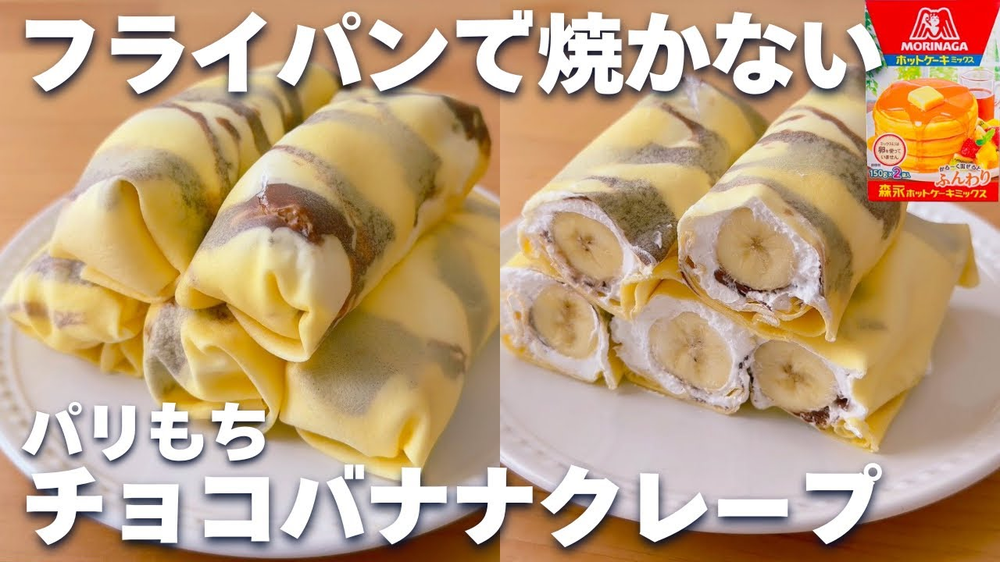

# 【レンジ1分10秒】ホットケーキミックス＆レンジで簡単☆チョコバナナクレープの作り方！パリもち食感♪

- 調べた日：2026-10-12（数字はいちばん新しい日の時点）
- チャンネル：ホッとケーキさん。（@hotcake-san、登録者 557,000人）
- 公開日：2026-08-15　長さ：6分14秒　形：横長
- 再生：2,380,671回（登録者の 4.3倍）　高評価：22,895　コメント：134
- URL：https://www.youtube.com/watch?v=rCllGp0CeXA

## サムネ

## 人気のコメント（いいねの多い順・上から10個）

1. （いいね 349）このクレープはターンテーブルのレンジだと生地が漏れ出してしまうので、フラットのレンジじゃないと上手く作れません。 ターンテーブルのレンジでは底が平らな平皿にラップをひいて作ると多少歪ですが、クレープが出来ますよ。
2. （いいね 167）50代半ばの私ですが、中学生の頃にラップにのばして作るこのやり方を友人に教わり作ってました❤ 冷凍して部活のオヤツに持って行ったなと懐かしく思いだしました😊
3. （いいね 80）これ、普通のチョコじゃなくてヌテラのチョコクリームにしたらクッソ美味かった😂
4. （いいね 73）子供の頃からチョコバナナクレープが好きだった
5. （いいね 39）冷やさずそのままチョコがトロトロの状態で食っても旨そうだ
6. （いいね 26）これ冷凍したらアイスみたくなるかな？
7. （いいね 22）天才かよ！😂
8. （いいね 22）こんにちは😊クレープは並んでまで食べるのしないので、スーパーかコンビニの折りたたみ系をもっぱら食べています。自分で作ったら欲張ってたくさん入れて巻けなくなる予感が😂でも簡単なので明日作ります！冷凍ブルーベリーとブルーベリージャムで作ってみます！いつもありがとうございます😊
9. （いいね 21）ミルクレープも出来そう🤤
10. （いいね 18）ラップに薄くマーガリンとか油を塗ったら良さそう

## メモ（なぜ伸びた？ 視聴者は何を求めている？）

- 
