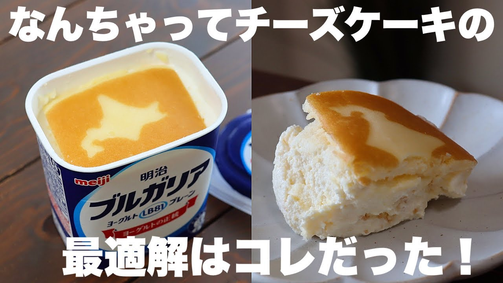

# 【材料2つ】チーズケーキはもう買わない！ゼラチン、チーズ、生クリーム不要！超濃厚なんちゃってチーズケーキの作り方！

- 調べた日：2026-10-12（数字はいちばん新しい日の時点）
- チャンネル：まんまるkitchen（@kitchen9883、登録者 427,000人）
- 公開日：2026-09-20　長さ：6分53秒　形：横長
- 再生：404,603回（登録者の 0.9倍）　高評価：2,896　コメント：126
- URL：https://www.youtube.com/watch?v=T0L43MlFT8k

## サムネ

## 人気のコメント（いいねの多い順・上から10個）

1. （いいね 82）面倒くさがりなので包丁出すのすら面倒臭いです！手でちぎっても良いですか？！良いですよね？！ありがとうございます！🤣
2. （いいね 52）これならめんどくさがり屋の私でも作れる👍
3. （いいね 48）至福のギリシャヨーグルトを未開封のまま倒して横向きで水切りしたあと、チーズ蒸しケーキを1個半使って作りました🤤濃厚でめちゃくちゃ美味しかったです🎉最高のレシピをありがとうございました
4. （いいね 44）分量計らなくて良いのでワタシにピッタリ あしたやってみます！
5. （いいね 41）あんなに30分で水が出て来るとは思わなかったです！ そして、水を切ったヨーグルトを入れ物に戻したら、半分位しか無くて、ヨーグルトの半分は水だったのか！！っと衝撃でした！ 美味しそうだし簡単なので、是非作ってみたいです！
6. （いいね 29）水切りギリシャヨーグルトと北海道チーズ蒸しケーキで作ってみました！ めっちゃ濃厚なのができてやばいうまいです！レシピありがとうございました！
7. （いいね 23）オイコスとかでやってもウマそう😊
8. （いいね 22）手を振ってくれるの嬉しいです🥹💕
9. （いいね 15）水切りするだけでやっぱり濃厚そうで美味しそう❣️絶対これ1回で食べちゃう😂
10. （いいね 15）大雑把な私にピッタリなレシピ、試してみます　大雑把ついでに…わたくし、箱ごとキッチンペーパーにヨーグルトをひっくり返して水切りしてます🤭

## メモ（なぜ伸びた？ 視聴者は何を求めている？）

- 
