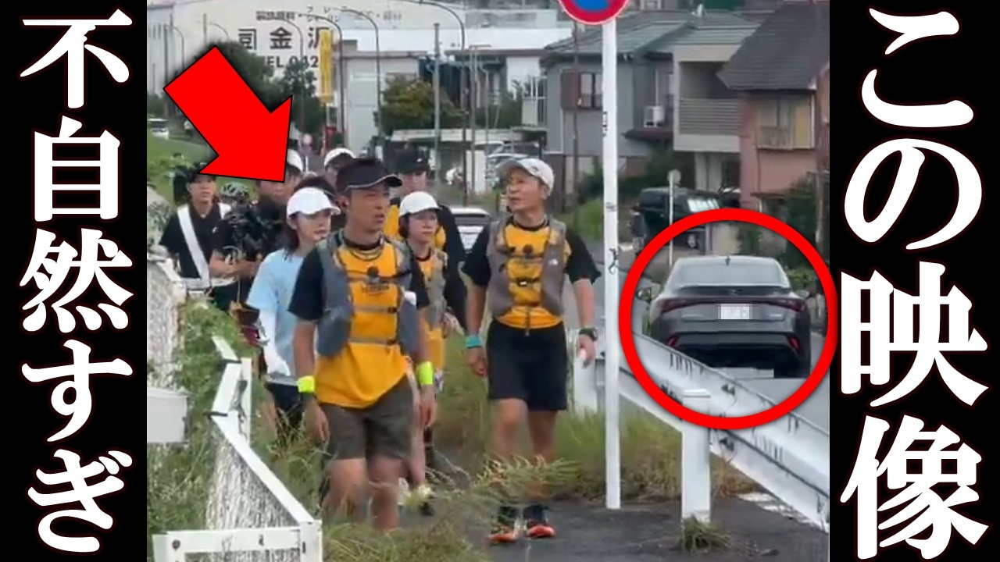

# 日テレ、24時間マラソンの衝撃の映像が拡散され、一同驚愕。

- 調べた日：2026-10-12（数字はいちばん新しい日の時点）
- チャンネル：コースケTV【時事ニュース】（@kosuketv、登録者 224,000人）
- 公開日：2026-09-01　長さ：13分56秒　形：横長
- 再生：1,834,706回（登録者の 8.2倍）　高評価：10,254　コメント：976
- URL：https://www.youtube.com/watch?v=xN3TZFUggrE

## サムネ

## 人気のコメント（いいねの多い順・上から10個）

1. （いいね 1,520）どうしてこんな偽善番組をみんな観るのかな？募金もしたくないしマラソンでいまだに感動する奴の気がしれない
2. （いいね 1,067）小池百合子は学歴詐称について説明しろ。
3. （いいね 1,044）都議会は恐ろしいね 小池王国になってるわ
4. （いいね 982）お上に逆らうと消されるって、、、 東京都議会、みどりの狸の闇は深い。 真実が明らかになることを願います。
5. （いいね 962）小池のリコール運動どうなったんでしょうか？
6. （いいね 627）ん？？都議って小池の暴走監視して都政を正しく回す役割では。 小池の逆鱗に触れて辞めさせられる？小池が都議の親分になってるのが大問題だと思うんだが。
7. （いいね 513）テレビ捨てましたが、あった時も芸能人のわざとらしいお涙頂戴が受け付けなくて昔から見てません
8. （いいね 474）親が特別学級行きを拒む大変な子を1年間面倒見た私の母は鬱になりましたので星野まりみたいなこと言ってるやつを見ると虫唾が走りますね。教員とその家族にも人生があります。
9. （いいね 432）日テレもTBSとあまり変わらない。
10. （いいね 427）信用してたのは間寛平さんだけでしたよ🇯🇵

## メモ（なぜ伸びた？ 視聴者は何を求めている？）

- 
