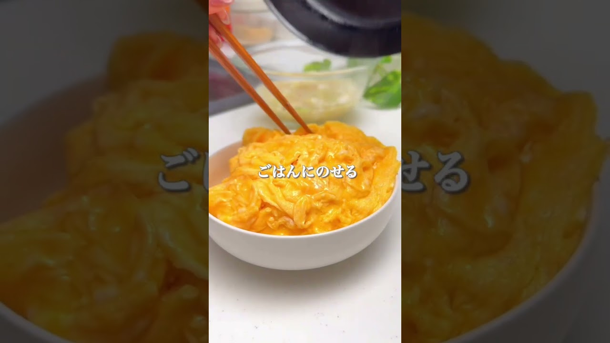

# パパっと作れる卵系【丼レシピ3選】バリエUPの参考になれば嬉しいです🥄✨

- 調べた日：2026-10-12（数字はいちばん新しい日の時点）
- チャンネル：maki | 今日の時短レシピ（@maki.recipe、登録者 98,100人）
- 公開日：2026-08-31　長さ：2分57秒　形：ショート（縦長）
- 再生：846,442回（登録者の 8.6倍）　高評価：32,985　コメント：166
- URL：https://www.youtube.com/watch?v=cKWTOJUbQRA

## サムネ

## 人気のコメント（いいねの多い順・上から10個）

1. （いいね 492）凄いいいねしたら🍴になった！
2. （いいね 275）これは罪深い 絶対美味しいやん
3. （いいね 123）卵が好きすぎる 最高すぎる 優しいくせにまあまあ罪深い
4. （いいね 117）くっ！材料が全部家にあるっ！ 美味しそうだ！！作るしかねぇ！！
5. （いいね 102）最初から調味料を混ぜて慌てないでできるよう工夫してるところもゆっくりした手つきで調理しているところも料理初心者が安心して見られる良い動画だと思います😊
6. （いいね 84）見た目が天津飯みたいで美味しそう 卵と米は大体美味い チーズはどうせ美味い
7. （いいね 51）お腹すいた人を待たせない、舌なめずりするぐらい美味しそうなレシピ。作り手にとってはきっとフライパンのお掃除が大変。そういう意味ではほんと食べる人のことに愛情を振り注いだメニューだと思いました。
8. （いいね 29）簡単でこういうのでいいだよって見本、明日作ろう😊
9. （いいね 16）昔みたいに卵10個入り1パックが特売日に108円で買えたのなら 手軽な卵料理だったんだけど…何だかんだで卵の値下げの気配が無いよね…(´・ω・｀)
10. （いいね 16）夜中に見るものじゃなかった🤤

## メモ（なぜ伸びた？ 視聴者は何を求めている？）

- 
