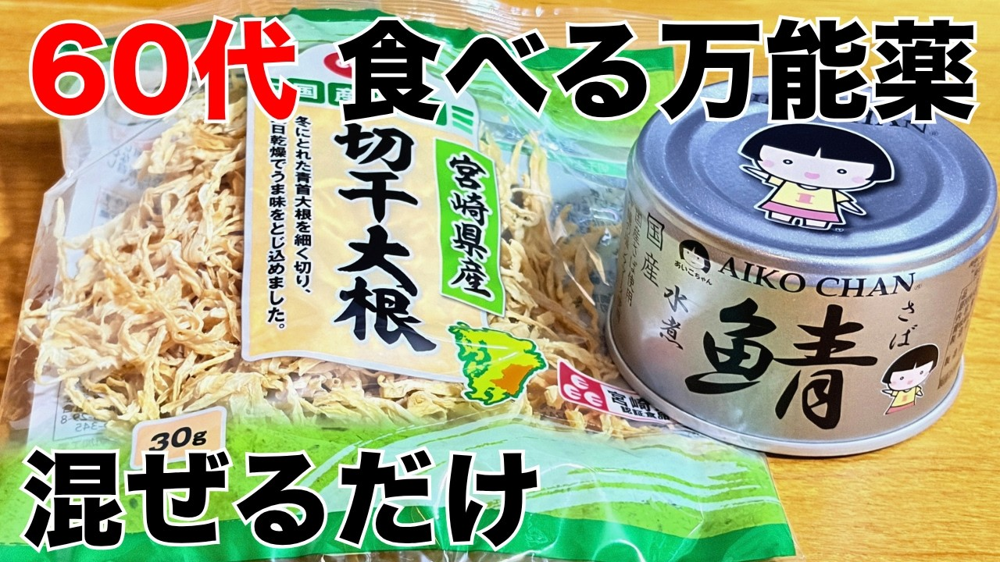

# 【血液サラサラ＆骨強化】火を使わず混ぜるだけ！切干大根のサバ缶漬け

- 調べた日：2026-10-12（数字はいちばん新しい日の時点）
- チャンネル：まみのおうちごはん（@mami_ouchigohan、登録者 25,200人）
- 公開日：2026-10-01　長さ：3分17秒　形：横長
- 再生：729,262回（登録者の 28.9倍）　高評価：2,198　コメント：29
- URL：https://www.youtube.com/watch?v=skS0HIW0vVo

## サムネ

## 人気のコメント（いいねの多い順・上から10個）

1. （いいね 17）切り干し大根なんて家で干して作ってたけどさ。買う切り干し大根ってどれが正解？家は切り干し大根にきのこや海藻入れてお浸しで良く食べましたよ😊
2. （いいね 13）火を使わなくて…めちゃくちゃ簡単ですね。  サバ缶も切り干し大根も大好きなので…作ります😋
3. （いいね 12）簡単に作ることが出来て美味しそうです😊この前、切り干し大根使ったけどまた買って作ろうと思いました。
4. （いいね 11）高齢で食が細くなってしまった両親がいます。健康のためにと鯖缶は常備していますので、さっそく作ってみたいと思います。他のレシピも参考にさせていただき自分のレパートリーも広げたいです。今後も簡単で美味しいレシピ期待しています。
5. （いいね 8）切り干し大根とサバ缶の組合せは知っていましたが、それでも臭みが気になっていました。生姜とお酢はなるほど！でした🎉　試してみます。
6. （いいね 7）お疲れ様です♪ これにニンジンの千切りを塩もみしたのを１０分ほど放置したの→良く絞ったの＋刻みあげを混ぜて似た様なの作ってます♬  おろし生姜が良い仕事しますね🌈🌈🌈
7. （いいね 7）簡単で栄養満点ですね～ サバ缶から溶け出る毒が無ければいいのですが😅
8. （いいね 4）我が家では切り干し大根を水で戻してから切り昆布乾燥したものをやはり水で戻し🥕を千切りして混ぜて漬物にして食べています切り昆布は乾燥したもの売って居ますが、我が家ではハリハリ漬けとよんでみんな大好物です日持ちもします😂
9. （いいね 4）切り干し大根を調理するときは、必ず火を使わないといけないと思っていました！ これなら手軽に作れます！
10. （いいね 3）美味しそうですね！😊作ってみます。ありがとうございます✨

## メモ（なぜ伸びた？ 視聴者は何を求めている？）

（2026-10-14 記入）
- なぜ伸びた：「血液サラサラ＆骨強化」で健康が気になる人をしぼり、「火を使わず混ぜるだけ」で楽さ。サムネ「60代 食べる万能薬」。登録2.5万人で73万回
- 視聴者が求めている：高齢の親のための健康料理、臭みを消すコツ（生姜・お酢）
- 使える要素：**年代と体にいいこと**で見る人をしぼる（小さいチャンネルでも効く）
