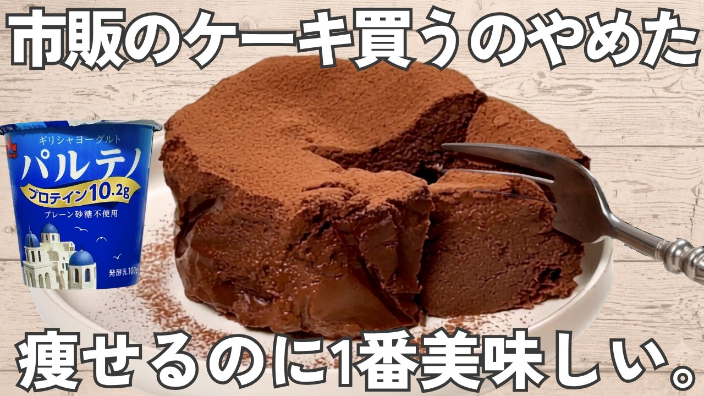

# 驚きの効果【濃厚チョコケーキ】高タンパク18.9g・白砂糖なし！市販より旨いのにヘルシー・美容おやつ

- 調べた日：2026-10-12（数字はいちばん新しい日の時点）
- チャンネル：ヘルシーおやつ / めいりり（@maylily__oyatsu、登録者 3,340人）
- 公開日：2026-09-04　長さ：1分52秒　形：横長
- 再生：280,128回（登録者の 83.9倍）　高評価：2,300　コメント：24
- URL：https://www.youtube.com/watch?v=rfSSNOtbFWo

## サムネ

## 人気のコメント（いいねの多い順・上から10個）

1. （いいね 21）これ本当に美味しくて高タンパクだから何回も作って食べちゃいます🫶🏻
2. （いいね 15）白砂糖無しって… 別の砂糖使ってるやん
3. （いいね 11）おいしそう！ てんさい糖の代わりにハチミツはつかえますかね？
4. （いいね 6）レンジで作れるのって手軽で助かります😊オーブンだと予熱とか時間かかるから…
5. （いいね 6）ヨーグルト使った特有の酸味ありますか？
6. （いいね 6）すごく美味しそうですね！ カロリーはどのくらいですか？
7. （いいね 6）パルテノもチョコも　高いやん？痩せるならやり甲斐ありそうやけど、痩せなんだら無意味や
8. （いいね 5）レシピ通りにつくったら、本当に美味しく出来ました🎉夫に出したらお店で買ってきたと思ったそう🍫
9. （いいね 4）種子島産サトウキビ100%入れます
10. （いいね 3）うわ〜っ、めっちゃ簡単

## メモ（なぜ伸びた？ 視聴者は何を求めている？）

- 
