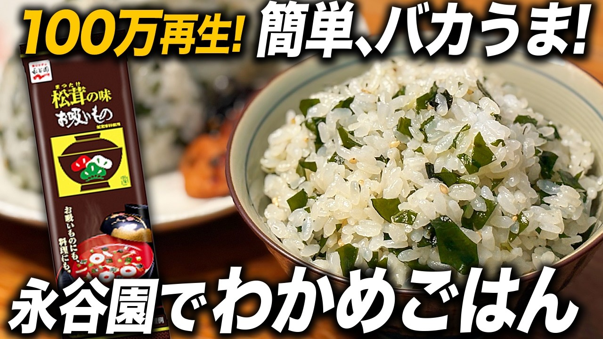

# 【100万再生!】松茸の味お吸いもので、バカうま！わかめごはん。おにぎりにも最高

- 調べた日：2026-10-12（数字はいちばん新しい日の時点）
- チャンネル：めしコイズミ（@meshikoizumi、登録者 29,500人）
- 公開日：2026-09-15　長さ：2分03秒　形：横長
- 再生：1,031,803回（登録者の 35.0倍）　高評価：5,274　コメント：137
- URL：https://www.youtube.com/watch?v=b0aqoNRBhJE

## サムネ

## 人気のコメント（いいねの多い順・上から10個）

1. （いいね 151）給食のわかめご飯は大好物でした！ なんなんだろう、あのうまさは。
2. （いいね 38）わかめご飯大好きー🫶🏻
3. （いいね 36）単純なんだけど、確かに旨いんだよな、、、　おにぎりにしても旨い　冷えても旨いんだわ
4. （いいね 16）まったく別の料理になりますが、お豆腐に乾燥わかめを混ぜておくおつまみにハマってます。オリーブオイルとレモン、少量の塩、できれば固めの木綿を水抜きしてから裏ごしした上でやるとカッテージチーズみたいになるんです。関係のない御話失礼😆
5. （いいね 13）永谷園のお茶漬けの粉で作ったおにぎりが大好物です 小さなあられが香ばしくて美味しいのよ
6. （いいね 11）最新作の永谷園まぜごはん第2弾はもっと美味しくできました！😏👍🏆✨  ▼混ぜるだけで絶品！バター香る「はまぐり出汁の極上まぜごはん」 https://youtu.be/LSwNMaEHlhQ
7. （いいね 11）業務スーパーで買ったわかめご飯の素が小学校の給食で食べたソレそのものだった めちゃうまでした
8. （いいね 11）お吸い物の素あれパスタにも使えるから使い勝手良いよね
9. （いいね 10）こっちは、今度のキャンプで作るよ❣️
10. （いいね 9）朝飯前に飯テロ

## メモ（なぜ伸びた？ 視聴者は何を求めている？）

（2026-10-14 記入）
- なぜ伸びた：永谷園のお吸いもの（だれでも知っている商品）で、給食のわかめごはんの懐かしさ。サムネに商品パッケージと「100万再生！」
- 視聴者が求めている：給食の思い出、冷えてもおいしい（おにぎり・お弁当）
- 使える要素：だれでも知っている商品名／懐かしさ（給食）
