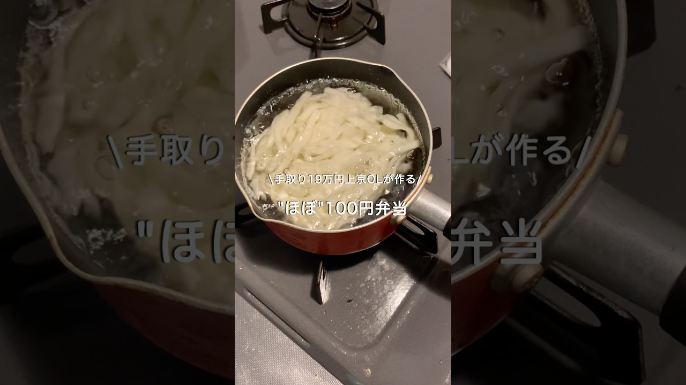

# 【手取り19万円上京OL】ほぼ100円弁当#自炊 #お弁当 #料理 #一人暮らし #簡単 #節約 #cooking #弁当 #lunchbox

- 調べた日：2026-10-12（数字はいちばん新しい日の時点）
- チャンネル：みぃ | 手取り19万円上京OL（@miicookinglog、登録者 28,600人）
- 公開日：2026-08-18　長さ：1分02秒　形：ショート（縦長）
- 再生：867,849回（登録者の 30.3倍）　高評価：6,000　コメント：80
- URL：https://www.youtube.com/watch?v=KeLUClR1Q-w

## サムネ

## 人気のコメント（いいねの多い順・上から10個）

1. （いいね 359）200円でも500円でも楽しみにしてます！！！
2. （いいね 314）丁寧に作られてますね。 １００円の日があってもたまに５００円とかもあってもよいと思います♪
3. （いいね 103）むしろ200円におさえられるのもスゴイ✨ 何円でも良いと思います✨美味しい物食べて、心も元気でいてくださいね😊
4. （いいね 91）コメントの内容を早速取り入れてて、流石だなと思いました！ 200円の日とかあってもいいと思います！食べたいものを食べるの大事😊  あと、地域やお店によって変わってきますが、うちの近くのお店では魚のアラを売ってて、それがとても安いです！ 朝イチでスーパーに行くと良いアラが普通の魚の1/3の価格で売られているので、買ったりしてます。 または遅い時間に値引きシール貼ってるのを狙ったり…  良い魚に出会えますように😊
5. （いいね 37）なんだか癖になる動画 息子も大きくなったらこんな感じで食費に悩みながらお弁当作ったりするのかな？とじんわりしながら見てます。ご褒美でもなんでも良いので若い人にはたくさん食べてほしいです、たまには豪華に食べてる様子見せてください！
6. （いいね 24）200円でも2000円でも 美味しく食べて仕事頑張れたら プライスレス✨
7. （いいね 22）見捨てないよ🍙
8. （いいね 17）スーパーのゆでうどん、体調悪い時には食べるけど、業務スーパーのうどん5食で200円切るし、レンチンできるし、讃岐うどんで硬いから一番好き
9. （いいね 17）値段にとらわれすぎず、食べたい物・作りたい物で楽しく投稿してください🫶🏻楽しみにしています！
10. （いいね 16）200円でも充分安いです！鮭や鯖はほぐしてごまや大葉と混ぜご飯にすると少ない量で満足感も出ておすすめです😊

## メモ（なぜ伸びた？ 視聴者は何を求めている？）

- 
