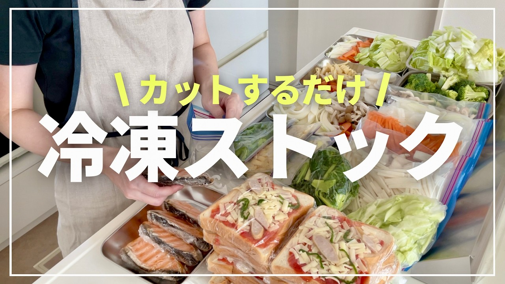

# 【冷凍保存】すぐに使える冷凍野菜など21種類/お弁当準備

- 調べた日：2026-10-12（数字はいちばん新しい日の時点）
- チャンネル：まとめ買い主婦【みいかわ】（@miikawa、登録者 67,700人）
- 公開日：2026-09-05　長さ：12分58秒　形：横長
- 再生：292,327回（登録者の 4.3倍）　高評価：0　コメント：8
- URL：https://www.youtube.com/watch?v=tGmmZnq5PKo

## サムネ

## 人気のコメント（いいねの多い順・上から10個）

1. （いいね 4）初コメです 冷凍ストックの参考にしたいなぁと拝見していますが、いつもやった気になって終わります💦 毎回結構な種類を仕込んでらっしゃいますが、冷凍庫は大容量なのでしょうか？ 我が家とどこが違うんだろう… いつも気になってます😅
2. （いいね 3）いつも楽しみに配信、待っています もうすっかり自分が作った気分です😅 ピサトーストいつもチーズを最後に散らすので具より先にしてみようと思います！
3. （いいね 2）すごいです。参考になります
4. （いいね 2）すごいです。参考になります

## メモ（なぜ伸びた？ 視聴者は何を求めている？）

- 
