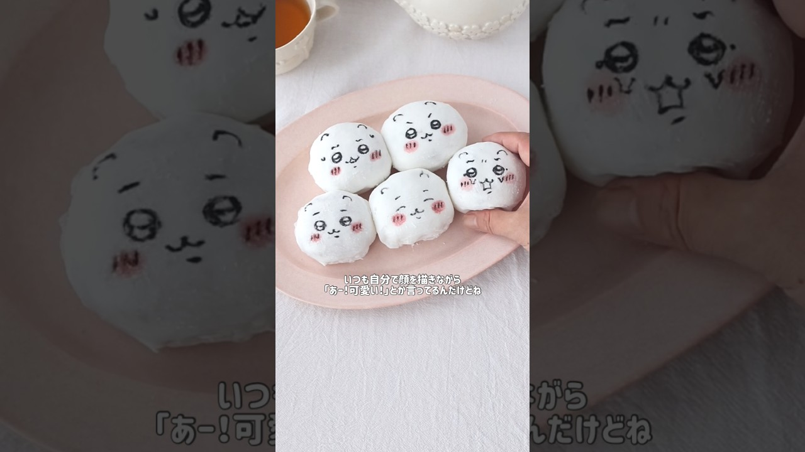

# @ricepaper_neki ライスペーパーネキからライスペーパートレイ送ってもらったからみかん生クリーム大福作ってみたよ#ちいかわ #お菓子作り#スイーツ#和菓子

- 調べた日：2026-10-12（数字はいちばん新しい日の時点）
- チャンネル：momo キャラ弁料理家（@momokyaraben、登録者 292,000人）
- 公開日：2026-07-16　長さ：1分01秒　形：ショート（縦長）
- 再生：3,206,688回（登録者の 11.0倍）　高評価：33,567　コメント：200
- URL：https://www.youtube.com/watch?v=fUNlb1YYC4s

## サムネ

## 人気のコメント（いいねの多い順・上から10個）

1. （いいね 1,360）ももさん「大好きです！（饅頭ﾌﾞﾁﾌﾞﾁｨ、、）」 ちいかわ「わ''あ''あ''あ''あ''泣泣😭」
2. （いいね 932）追記※片栗粉は生で食べない方がいいとコメントで教えていただきました。気になる方はコーンスターチで作ってくださいね！  白い大福ということで大好きなちいかわちゃんにしちゃいました♡ ちいかわちゃんの泣いてる顔が好きとか言いながら、引き裂いてごめんなさい😂
3. （いいね 877）「特に泣いているお顔が大好きです」 ワイ「マジやん！かわいいーーー！」 （大福ﾌﾞｯﾁﾌﾞﾁ） ワイ「ﾜ…ﾜｧ…（泣）」
4. （いいね 723）泣いてるかお好きはドS
5. （いいね 465）ライスペーパーは水に浸すというより、広くて浅いお皿に水を入れてそこに｢くぐらせる｣くらいで充分です。 最初は硬いですが、数秒で柔らかくなるので大丈夫です。
6. （いいね 214）顔が伸びるとこで爆笑したwwwwww
7. （いいね 108）千切られてるちぃちゃん可哀想可愛い😂💕
8. （いいね 44）愛のあるちい虐動画だ…！！
9. （いいね 25）お顔書くの上手ですね😊
10. （いいね 21）最後の萌え断制作中の笑いながら喋るのつられちゃって声出して笑った笑笑笑笑笑笑

## メモ（なぜ伸びた？ 視聴者は何を求めている？）

- 
