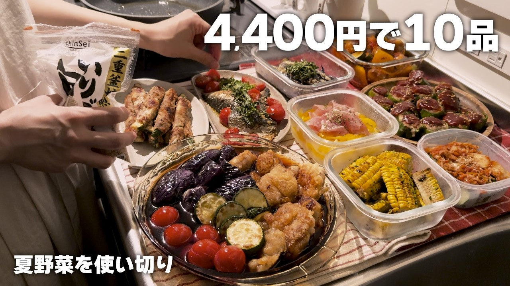

# 【4,400円で10品】夏野菜をムダなく使い切る作り置き｜食べ盛り夫婦の連休キッチンVlog

- 調べた日：2026-10-12（数字はいちばん新しい日の時点）
- チャンネル：ナナミご飯暮らし（@nanami.cooklife、登録者 9,160人）
- 公開日：2026-08-02　長さ：20分37秒　形：横長
- 再生：190,363回（登録者の 20.8倍）　高評価：1,302　コメント：33
- URL：https://www.youtube.com/watch?v=NlZ_ucirkV0

## サムネ

## 人気のコメント（いいねの多い順・上から10個）

1. （いいね 25）美味しそう！すごいです！ひとつだけ気になったのは、①のたまねぎ、切ってスライサーにかけるのではなく、丸いままスライサーにかけて、ちょうどいい量でやめればいいのではないかしら？横からすみません。
2. （いいね 9）美味しそう…お店みたい… ちょこちょこ入るナナミさんの実況が可愛いです笑 これからもお声入れていただけると癒されます✨
3. （いいね 9）4400円で10品マジ？！？！ 尊敬しかない…✨✨
4. （いいね 7）ピーマン🫑の肉詰め、そのまま丸まるやっちゃいます🤣(ズボラ) ですが、オットには輪切りよりも丸まるのが美味しいと言われます😊☺️ ズッキーニの肉巻き、いつも焼肉のタレで味付けするので、バター🧈とニンニク🧄してみます！🫶
5. （いいね 7）ナスも玉ねぎもヘタと芯を大きく切りすぎて勿体ないと思っちゃいました😅 玉ねぎは水じゃなく空気に晒すと絡み抜けてビタミンも流れ出ないのでオススメです👍
6. （いいね 5）ここのお家の子になりたい笑
7. （いいね 5）ナス全滅ですか？かった店舗に持って行き交換されなかったのかな？
8. （いいね 4）美味しそう、、将来の旦那さんに作ってあげたい🤤  何で撮影されてますか？？画質が綺麗なのと温かみがあって大画面で見応えあります🥺
9. （いいね 2）レシピに行き詰まってたのでたくさん美味しそうな夏野菜のメニューがあって助かりました😭ぜひ作ってみます！
10. （いいね 2）山形県産トマトがうれしい😊 全部おいしそうです！

## メモ（なぜ伸びた？ 視聴者は何を求めている？）

- 
