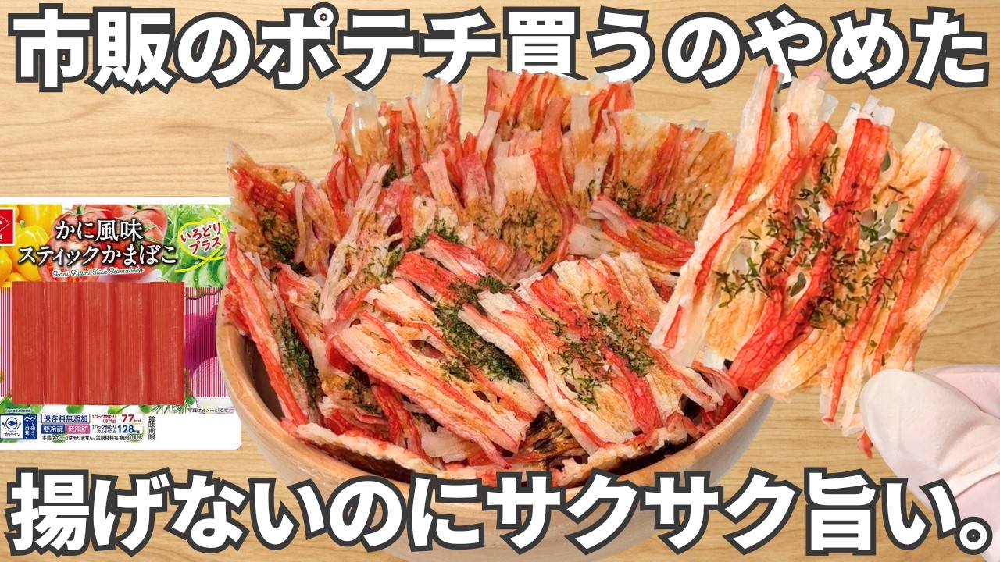

# 簡単3分【のり塩カニカマチップス】旨すぎる！高タンパク・低脂質でダイエット中におすすめ！おつまみ

- 調べた日：2026-10-12（数字はいちばん新しい日の時点）
- チャンネル：おつまみチャンネル（@otsumami_ch、登録者 178,000人）
- 公開日：2026-09-05　長さ：1分22秒　形：横長
- 再生：2,815,946回（登録者の 15.8倍）　高評価：17,369　コメント：345
- URL：https://www.youtube.com/watch?v=SU0N0rZeqB0

## サムネ

## 人気のコメント（いいねの多い順・上から10個）

1. （いいね 1,044）カニカマもまさか自分がサクサクするとは思ってなかったでしょうね
2. （いいね 360）これ、デンプンで増量してる安物のほうがむしろせんべい向きでおいしいというのがいいね。
3. （いいね 291）レシピはお手軽、かつ余計な前置きとか余談等が無くてとても見やすい。
4. （いいね 215）レンジ調理なのが神ですね オーブンだったら躊躇う
5. （いいね 213）一味か七味を振り掛けても良さそう😊 良いネタありがとうございます
6. （いいね 189）普段サラダとかに普通に入れるけどこれ入れたらクルトンみたいにサクサクしてそうだし映えそうやな
7. （いいね 174）他の方々も仰っていますが…レシピがシンプルで見やすく、余計な前置きや自分語り等がなくとても印象が良いです ただし、カニカマは高たんぱく・低脂質ではありますが、同時に練り製品でもあるため塩分を多く含みます ご賞味の際は一日３本分程度の分量にしていただくか、減塩タイプの商品を用いる事をおすすめします
8. （いいね 167）とろけるチーズ乗せても美味しそう
9. （いいね 133）買ってもすぐ賞味期限来てダメになっちゃうからこれやってみよ!ありがとうです〜
10. （いいね 126）恐ろしく簡潔な動画で驚いた キューピーも脱帽モノだろこれ

## メモ（なぜ伸びた？ 視聴者は何を求めている？）

（2026-10-14 記入）
- なぜ伸びた：1本目（かまぼこ）と同じ型を、別の材料でくり返して当てた。「カニカマがサクサクになる」の意外さ
- 視聴者が求めている：レンジでできること（「オーブンだったらためらう」）、前置きがなく見やすいこと、安い材料のほうが向いている気楽さ
- 使える要素：当たった型は材料を変えて続けて出す（シリーズにする）
