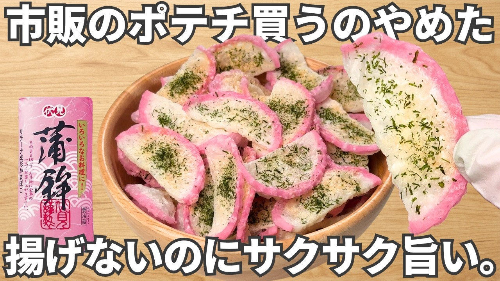

# 簡単2分【のり塩かまぼこチップス】旨すぎる！高タンパク・低脂質でダイエット中におすすめ！おつまみ

- 調べた日：2026-10-12（数字はいちばん新しい日の時点）
- チャンネル：おつまみチャンネル（@otsumami_ch、登録者 178,000人）
- 公開日：2026-10-04　長さ：1分30秒　形：横長
- 再生：4,878,101回（登録者の 27.4倍）　高評価：36,162　コメント：618
- URL：https://www.youtube.com/watch?v=oqd4aIuYAlA

## サムネ

## 人気のコメント（いいねの多い順・上から10個）

1. （いいね 1,067）スーパーでカマボコが賞味期限近くなって安売りされてるのを時々見るから、次見つけたら買ってこれを試してみよう。
2. （いいね 634）他の人達みたいに自分語りが無いのでめちゃくちゃ見やすくて助かってます。
3. （いいね 577）薄く切った時点で、半分くらい食べてしまいそう…！🍺😅
4. （いいね 568）このかまぼこの板、ネギを切ったり大きいまな板出したくない時に便利
5. （いいね 556）これ、はんぺんでしても美味しいですよ！
6. （いいね 426）やろうと思って買ってきたけどそのまま食べちゃったのでもう1回買ってきます
7. （いいね 384）蒲鉾は確かに高たんぱく低脂肪だが高塩分なのでご注意を。
8. （いいね 317）とうとう…蒲鉾が……ww 蒲鉾でなくなる日が来るなんて（笑）
9. （いいね 286）板から剥がしたときに残る薄い切れ端が好きな人いる??
10. （いいね 177）２回作ってみましたが、かまぼこ１本分のスライスを加熱するとレンジの中が水蒸気だらけになって全然乾燥しませんｗ たぶん動画のように少量ずつ加熱しないと乾燥させられないんだと思います ドアの水滴も毎回水滴だらけになるし、簡単２分と言いつつ盛り付けのように１本分ぐらい作ろうとすると大変ですよｗ ノンフライヤーとかでやれば多少マシなのかな？

## メモ（なぜ伸びた？ 視聴者は何を求めている？）

（2026-10-14 記入）
- なぜ伸びた：かまぼこ（安い・身近）が「ポテチ」に化ける意外さ。サムネ「市販のポテチ買うのやめた／揚げないのにサクサク旨い」で、お菓子を我慢している人の言い訳（高タンパク・低脂質）まで用意している。1分で話なし
- 視聴者が求めている：安売りのかまぼこで試せる手軽さ（1位「賞味期限近くの安売りで試そう」）、自分語りがなくすぐ見られること（2位）、はんぺんでもできるなどの応用
- 使える要素：身近な安い材料→別のお菓子に化ける／「揚げないのに」／ダイエットの言い訳／話さない短い動画
