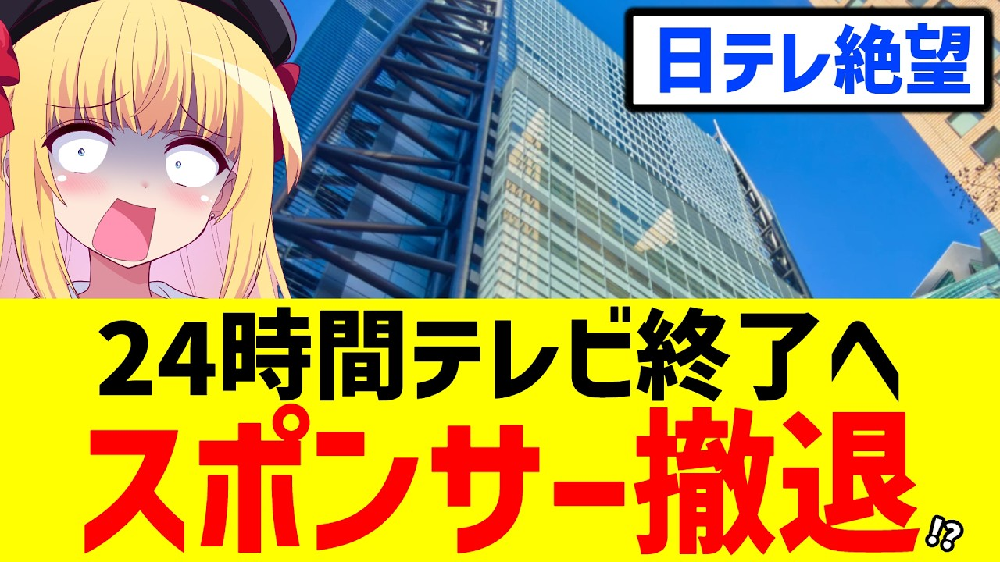

# 24時間テレビ、絶望的な視聴率とスポンサー撤退で終了寸前!?【日テレ】

- 調べた日：2026-10-12（数字はいちばん新しい日の時点）
- チャンネル：パウラちゃんねる（@paurach、登録者 145,000人）
- 公開日：2026-09-01　長さ：13分08秒　形：横長
- 再生：455,001回（登録者の 3.1倍）　高評価：6,287　コメント：1,498
- URL：https://www.youtube.com/watch?v=jcH23aix3Vw

## サムネ

## 人気のコメント（いいねの多い順・上から10個）

1. （いいね 1,660）日産は自社が死にかけてんのに、24時間テレビのスポンサーなんかやっとる場合か？ さっさと自社再建に力入れろ。
2. （いいね 1,537）日産まだやってたのかよ まずは従業員を救えタコ
3. （いいね 1,492）日産とイオンはスポンサーしてる場合じゃないだろ
4. （いいね 882）これだけ問題起こしてるのに寄付する意味がわからない
5. （いいね 786）寄付するところなんてたくさんあるのに、なぜわざわざ着服した団体に寄付する人がたくさんいるのか理解できない。
6. （いいね 643）着服バレた時点で撤退しないのが不思議だったがついにか
7. （いいね 509）あの寄付金って、日産から福祉車両を買って施設に配るっていうマネロンでしょ
8. （いいね 496）出演者のほぼ全てが謝礼という名目のギャラをもらっている以上、チャリティーと銘打つ資格はない。
9. （いいね 441）フジが27時間テレビやめたんだから、日テレも24時間テレビやめようか
10. （いいね 398）横領があった時点、もう終了でしょうと思うんですが。

## メモ（なぜ伸びた？ 視聴者は何を求めている？）

- 
