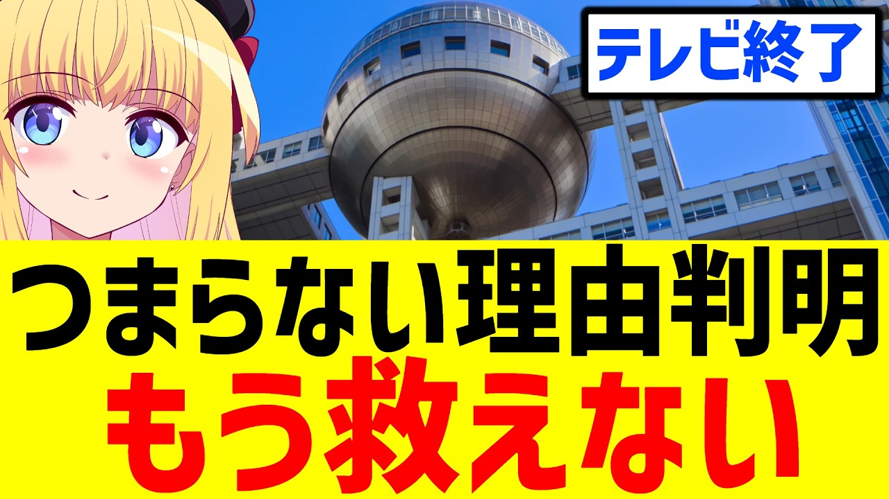

# フジテレビの打ち切り番組で「地上波はなぜつまらないのか」の理由が分かりました【指原千夏】

- 調べた日：2026-10-12（数字はいちばん新しい日の時点）
- チャンネル：パウラちゃんねる（@paurach、登録者 145,000人）
- 公開日：2026-09-11　長さ：11分26秒　形：横長
- 再生：227,508回（登録者の 1.6倍）　高評価：3,210　コメント：929
- URL：https://www.youtube.com/watch?v=D4q4VVChFGc

## サムネ

## 人気のコメント（いいねの多い順・上から10個）

1. （いいね 546）つまらないならまだ良い 不愉快通り越して腹が立つまできてるからどうしようもない
2. （いいね 500）YouTube見てた方がオモロイ
3. （いいね 357）このチャンネルではじめて知った番組が多そう
4. （いいね 259）と言うか「お散歩」も「グルメ」も朝から夕方までの各番組でしつこいほど垂れ流しているからねぇ。 番組名が違うだけでやってる事は朝から晩までほぼ同じじゃそりゃ誰も見なくなりますて・・・
5. （いいね 239）フジテレビは番組がコンテンツではない、不祥事こそフジテレビのコンテンツ。 番組は不祥事起こすための準備段階。
6. （いいね 234）もう動物園の動物たちがエサ食ってる映像流した方が視聴率取れるよ…
7. （いいね 225）自分たちがつまらない事に気がついてないのが致命的
8. （いいね 223）今のテレビ局にいる人達はそもそも面白い番組ってのが何なのかよくわかってないんだろうな。
9. （いいね 204）早く電波手放せよ赤字が膨らむだけだぞ
10. （いいね 196）おばちゃん達の話しだけで番組やろうとする人達が無能すぎる。

## メモ（なぜ伸びた？ 視聴者は何を求めている？）

- 
