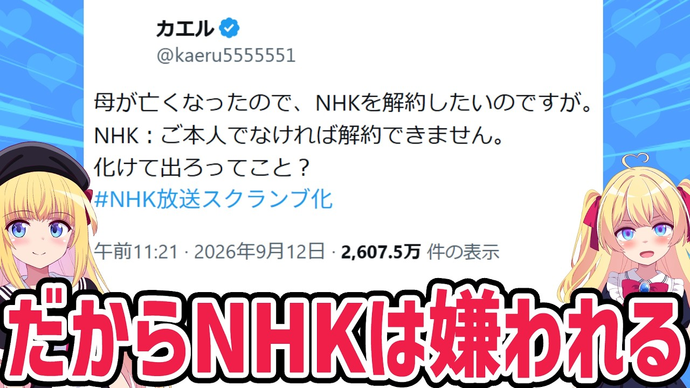

# NHKがマジで嫌われた結果、受信料欲しさに法的措置で取り立てへ。。。

- 調べた日：2026-10-12（数字はいちばん新しい日の時点）
- チャンネル：パウラちゃんねる（@paurach、登録者 145,000人）
- 公開日：2026-09-13　長さ：12分47秒　形：横長
- 再生：178,421回（登録者の 1.2倍）　高評価：2,601　コメント：621
- URL：https://www.youtube.com/watch?v=ZtxcjvitG0A

## サムネ

## 人気のコメント（いいねの多い順・上から10個）

1. （いいね 415）やってる事が反社と変わらない。
2. （いいね 356）だから、生きてる間から受信料払ったら駄目って事だね
3. （いいね 315）NHKは解体させるしかない
4. （いいね 228）悪質過ぎる。もはや詐欺だ。政府何とかしろ。
5. （いいね 217）もうそこまでして見たいコンテンツじゃないのよ
6. （いいね 213）テレビ無いから払ってないが NHK気持ち悪い
7. （いいね 211）子ども時代、集金に親が不在を伝えたらキミが居てるやろ？キミが払って？とか言われた たまたま隣の人がそれを聞いてブチ切れて追い返してくれたけどNHKは昭和から何も変わってない
8. （いいね 197）NHKの存在を許してはいけない。悪そのもの。
9. （いいね 186）ヤラセ・偏向報道・ポリコレドラマと見たくない要素だらけ
10. （いいね 124）もう死に体なのに無理やり延命させてるのがおかしいんだよ。

## メモ（なぜ伸びた？ 視聴者は何を求めている？）

- 
