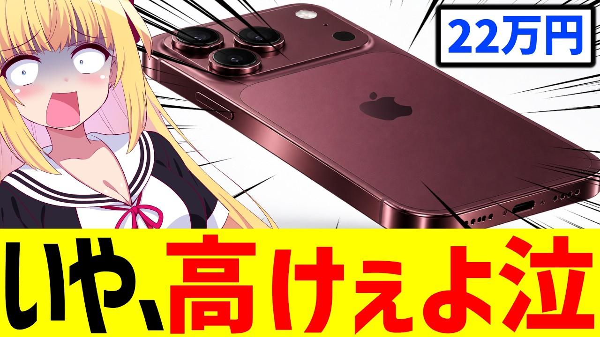

# 新しいiPhone「最安22万円」と判明→日本の消費者の目が覚めてしまう。。。【iPhone18Pro】

- 調べた日：2026-10-12（数字はいちばん新しい日の時点）
- チャンネル：パウラちゃんねる（@paurach、登録者 145,000人）
- 公開日：2026-09-18　長さ：9分29秒　形：横長
- 再生：170,174回（登録者の 1.2倍）　高評価：2,713　コメント：1,012
- URL：https://www.youtube.com/watch?v=onrAZhRhURI

## サムネ

## 人気のコメント（いいねの多い順・上から10個）

1. （いいね 436）「残クレiPhone」爆誕
2. （いいね 384）正直カメラが出っ張り始めた時にはジョブズの思想は消え去ってると思う
3. （いいね 324）22万以上払ってやることがSNSなの草
4. （いいね 286）ブッチャケた話。ソシャゲやらない人なら Androidのミドルどころか ロースペックのエントリーモデルで 十分事足りるよね
5. （いいね 218）電池交換するなら新しいの買おう、という層も消えるね。
6. （いいね 189）もうジョブズはいないじゃない
7. （いいね 158）正直、この価格ならそこそこ良いPCを持ち歩いているレベルだよな。 携帯端末にそこまでの機能盛り込む必要あるの？って疑問が出てくる。
8. （いいね 134）ずっとAndroidなのでどうでも良い😄
9. （いいね 133）もうガジェットではなくて宝石やブランド鞄の類だと思ってる
10. （いいね 130）iphone大好き日本人→どうせ買うんでしょって見下されてる感が草www

## メモ（なぜ伸びた？ 視聴者は何を求めている？）

- 
