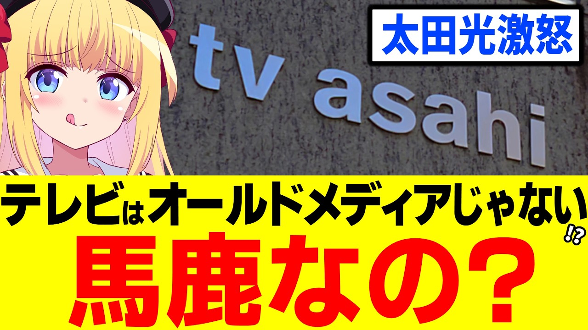

# 太田光「テレビをオールドメディア呼ばわりするな！」→嘲笑されるレベルの勘違いはなぜ生まれるの？【テレビ朝日　永野＆くるまのひっかかりニーチェ】

- 調べた日：2026-10-12（数字はいちばん新しい日の時点）
- チャンネル：パウラちゃんねる（@paurach、登録者 145,000人）
- 公開日：2026-10-04　長さ：16分52秒　形：横長
- 再生：443,152回（登録者の 3.1倍）　高評価：5,364　コメント：1,860
- URL：https://www.youtube.com/watch?v=F96tdt5hnL4

## サムネ

## 人気のコメント（いいねの多い順・上から10個）

1. （いいね 1,129）オールドメディアの象徴みたいな太田がそれを言うのか
2. （いいね 1,109）「オールド」っていわれるのは「古いから」じゃなくて「古いままだから」だと思う。
3. （いいね 891）有害メディアと呼べばいいのか？
4. （いいね 875）じゃあ有害メディアで
5. （いいね 598）テレビが太田を使っている理由が、そのままテレビ離れの原因になる。
6. （いいね 597）偏向報道メディアって呼べばいい？
7. （いいね 548）そうだね、オールドメディアですらないよね。 もうオワコンですよね。
8. （いいね 475）太田光は自分を頭が良いと思い込んでるバカの典型だからな。
9. （いいね 464）プロだろうが何だろうが 詰まらないものは詰まらないのよねー
10. （いいね 395）反応すれば、するほど 「効いてるｗｗｗ効いてるｗｗｗ」 じゃね？

## メモ（なぜ伸びた？ 視聴者は何を求めている？）

- 
