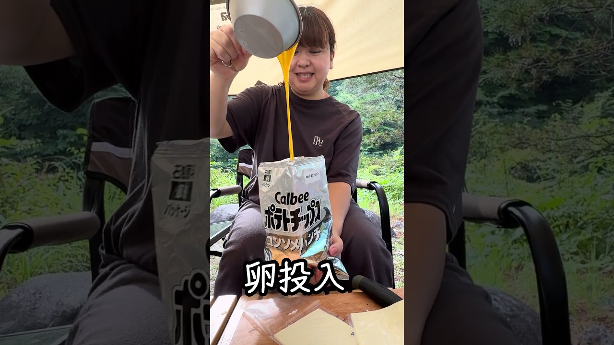

# ポテチで作る簡単キャンプ飯　　石油節約バージョン

- 調べた日：2026-10-12（数字はいちばん新しい日の時点）
- チャンネル：らいあんちゅーぶ　キャンプ編（@raiantube、登録者 1,710人）
- 公開日：2026-08-14　長さ：1分08秒　形：ショート（縦長）
- 再生：2,905,887回（登録者の 1699.3倍）　高評価：11,537　コメント：547
- URL：https://www.youtube.com/watch?v=3rLNY3FNLS8

## サムネ

## 人気のコメント（いいねの多い順・上から10個）

1. （いいね 523）ポテチ好きそうな顔してる😂
2. （いいね 301）完成品が想像以上に美味しそうに出てきた
3. （いいね 158）発想が天才
4. （いいね 68）一枚食べると思ったら裏切らず食べてくれて安心した😂
5. （いいね 64）へーこれは美味しいそう 簡単ですね!!! 鍋洗う必要無いのが素晴らしいアイデア
6. （いいね 64）ポテトチップが良く似合うな😅
7. （いいね 52）チョー高カロリー！ うますぎるでしょ。
8. （いいね 50）なんだろう。いっちばんに食べる事好きな感じ出てる
9. （いいね 45）開けたら１つ食べたくなるわな
10. （いいね 43）ピザポテトで試してみたい

## メモ（なぜ伸びた？ 視聴者は何を求めている？）

- 
