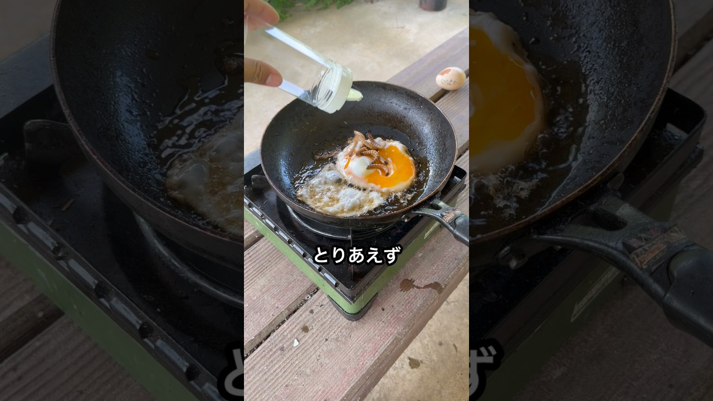

# 料理初心者が目玉焼きを作った結果…

- 調べた日：2026-10-12（数字はいちばん新しい日の時点）
- チャンネル：飯島レンジ / Renji Iijima（@renji_iijima、登録者 1,150,000人）
- 公開日：2026-07-25　長さ：1分05秒　形：ショート（縦長）
- 再生：3,527,789回（登録者の 3.1倍）　高評価：69,005　コメント：1,649
- URL：https://www.youtube.com/watch?v=4X0cepj7dPA

## サムネ

## 人気のコメント（いいねの多い順・上から10個）

1. （いいね 15,685）当然のようにクジャクの死骸出てきてびっくり
2. （いいね 7,999）飛び散った卵の中身後ろの鳥にめちゃくちゃかかってて笑う
3. （いいね 4,195）「いきなり卵を握り潰す」「クジャクの死体登場」「目玉焼きにワームを投入」「結局目玉焼き食べない」意味わかんなすぎて草
4. （いいね 3,576）夏にぴったりな恐怖映像
5. （いいね 2,847）クジャクの死骸、あんな派手でオシャレで豪華な羽を見せびらかしてても結局は生き物だからそのうち醜く朽ちるっていうのに風情を感じてしまった。
6. （いいね 2,249）ソース←わかる ケチャップ←わかる マヨネーズ←わかる ワーム←？？？？？
7. （いいね 2,182）（なんだ…今日は普通に料理か……） ミルワームポイッ ヒェッ
8. （いいね 1,993）クジャクの子供がずっと肩のうえにいるの可愛い
9. （いいね 1,306）レンジさんの肩から「何食べてるんだろう？」って覗きこんでるクジャクちゃん可愛い
10. （いいね 1,259）卵素手で握り潰すの強すぎて草

## メモ（なぜ伸びた？ 視聴者は何を求めている？）

- 
