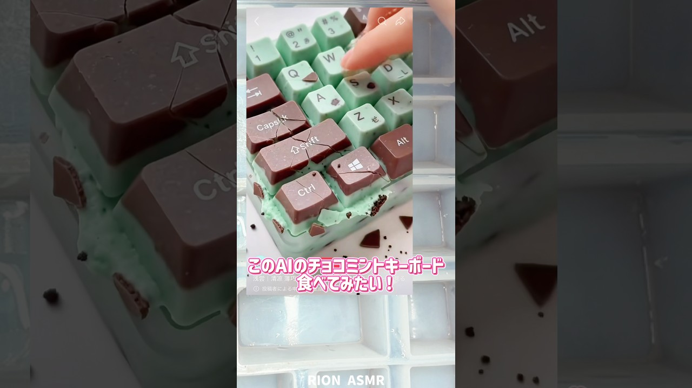

# チョコミントキーボード作ってみたよ！大変だった！#asmr #お菓子作り #recipe #再現レシピ #チョコレート

- 調べた日：2026-10-12（数字はいちばん新しい日の時点）
- チャンネル：RION りおんASMR（@rionasmr5337、登録者 254,000人）
- 公開日：2026-08-21　長さ：1分18秒　形：ショート（縦長）
- 再生：2,580,326回（登録者の 10.2倍）　高評価：54,268　コメント：208
- URL：https://www.youtube.com/watch?v=PJNKlrlepKU

## サムネ

## 人気のコメント（いいねの多い順・上から10個）

1. （いいね 7,256）器用というかもうほぼ根性と執念ですごい
2. （いいね 3,030）まずAIの物を作るのが凄すぎる！ 作るのも上手👏
3. （いいね 1,328）えっ、完成系が完璧すぎない？？ 相当大変だったろうにこんな上手に完成させるの流石すぎます
4. （いいね 1,109）すげー。。クリエイティブすぎる
5. （いいね 546）最後まで作り切ったことがまず素晴らしい もちろん作品もすごい
6. （いいね 254）止まらないRIONさん笑笑 すごすぎですほんとに😳😳
7. （いいね 188）オイルスプレーかけてからだったら外れやすいかも
8. （いいね 74）器用すぎて🎩
9. （いいね 43）天才か！👏すごい時間かかったでしょうね……キーボード可愛いし音もよくて最高
10. （いいね 27）すぐ行動するとかまじ尊敬❣️食べれるとかもう最高😚

## メモ（なぜ伸びた？ 視聴者は何を求めている？）

- 
