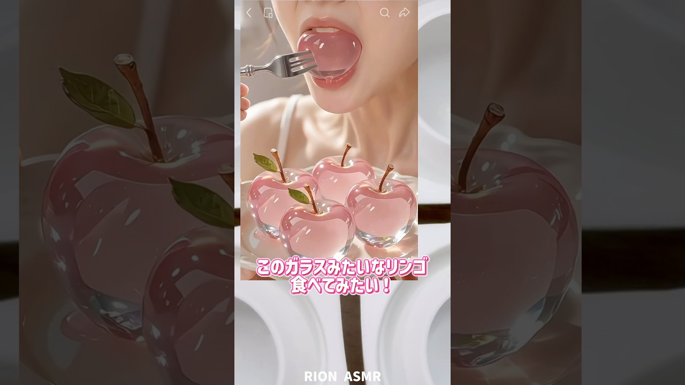

# ガラスみたいなリンゴ作ってみたよ！EDIBLE GLASS APPLE#recipe #お菓子作り #再現レシピ #りんご#apple

- 調べた日：2026-10-12（数字はいちばん新しい日の時点）
- チャンネル：RION りおんASMR（@rionasmr5337、登録者 254,000人）
- 公開日：2026-09-03　長さ：1分05秒　形：ショート（縦長）
- 再生：4,084,878回（登録者の 16.1倍）　高評価：68,358　コメント：177
- URL：https://www.youtube.com/watch?v=653gxLyLEOw

## サムネ

## 人気のコメント（いいねの多い順・上から10個）

1. （いいね 5,797）え！！もう既に大成功なのがわかる！！
2. （いいね 3,869）パラチニットバーナーとかでちょっと炙って溶かしたら気泡とか消えてつやでる気がする！
3. （いいね 2,582）AIの食べ物を再現するのすごい！
4. （いいね 795）まじで天才的に上手いな！？
5. （いいね 613）よいこのみんなは、 パラチニット扱う際は食用ゴム手袋使ってね😭
6. （いいね 185）パラチでとある人思い出した😂
7. （いいね 172）こういうAIに挑む動画いいねえ 増えて欲しい
8. （いいね 124）天才すぎん?? ショートだけど再現度高いのが伝わる…
9. （いいね 97）個人的には音重視の方の見た目、見た目重視の方の音が好き🫶笑
10. （いいね 97）完成度高すぎる！

## メモ（なぜ伸びた？ 視聴者は何を求めている？）

- 
