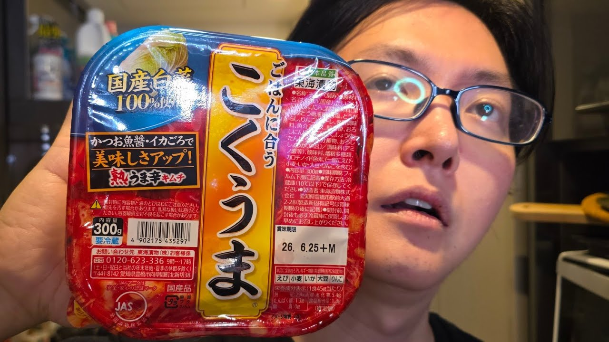

# ウマすぎてガチで大賞を獲った雑めしの作り方

- 調べた日：2026-10-12（数字はいちばん新しい日の時点）
- チャンネル：料理研究家リュウジのバズレシピ（@ryuji825、登録者 5,690,000人）
- 公開日：2026-10-05　長さ：16分12秒　形：横長
- 再生：676,561回（登録者の 0.1倍）　高評価：4,066　コメント：227
- URL：https://www.youtube.com/watch?v=Ta2qan_oIBU

## サムネ

## 人気のコメント（いいねの多い順・上から10個）

1. （いいね 129）お料理って面倒だと思っていた73年間😂 結構たのしかったんだ😊 ありがとう
2. （いいね 86）やけくそシリーズどんどん出してほしい
3. （いいね 85）いつも夕飯時にアップロードしてくれてありがとうなリュウジ
4. （いいね 77）納豆は中粒以上だと豆の水分でカビが納豆菌に勝って生えてきてダメになる事がありますが、小粒以下だと乾燥はするけど納豆菌が支配してるので、乾燥してカリカリになるまで放置した物でも安心して食べてます。
5. （いいね 38）善のおじさんでバカセが満場一致なのそれはそうw
6. （いいね 35）納豆バージョン、リュウジさんはタンパク質を重視してたけど、めっちゃ腸活にいいレシピだと思った💡
7. （いいね 23）「一生一緒にいれるよ」 「具のない食事でも笑って食べられるようなそんな関係」 ちいかわのチャルメラの話思い出してほっこりした☺️
8. （いいね 22）こうゆうのがいいんだよ！
9. （いいね 20）納豆バージョン早速作りました！ 美味いですこれ。すぐできた。パフォーマンスが良すぎる。
10. （いいね 18）こくうま美味いよなぁ〜キムチで一番好き

## メモ（なぜ伸びた？ 視聴者は何を求めている？）

- 
