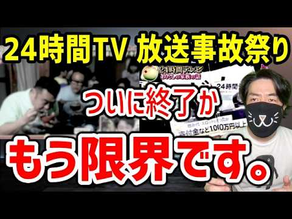

# 24時間テレビ、今年はさすがにヤバい。放送事故連発で露呈した限界

- 調べた日：2026-10-12（数字はいちばん新しい日の時点）
- チャンネル：元テレビDさっきー テレビで言えない話（@sakki-tvch、登録者 143,000人）
- 公開日：2026-09-01　長さ：12分05秒　形：横長
- 再生：1,065,531回（登録者の 7.5倍）　高評価：10,503　コメント：1,462
- URL：https://www.youtube.com/watch?v=ZLCgBqOdgvE

## サムネ

## 人気のコメント（いいねの多い順・上から10個）

1. （いいね 1,773）私が実家に帰った時、近くの幼稚園で撮影をしていたんですけど、自宅の窓を開けてみていたら、「開けるな！」と怒鳴られました。 今考えてみたらふざけていますね。
2. （いいね 1,632）ギャラが出るチャリティー番組なんて、そもそも、有り得ない。そのギャラを募金しろ。
3. （いいね 1,450）この偽善番組は本当に見たく無い… 何で毎年マラソンする必要があるの？ 早くこの偽善番組は終わって欲しい…
4. （いいね 1,270）マラソン中に乱入されたくなかったら24時間トラックコースだけ走っとけ
5. （いいね 1,125）言われてみれば確かに。放送中だからといって当然の権利のように公道を占拠していた今までがおかしいですよね。
6. （いいね 1,021）国旗損壊罪のときにはさんざん「表現の自由がー」って言っていたのに。
7. （いいね 978）もうテレビから電波取り上げろ
8. （いいね 918）さっさと24時間テレビは終了して欲しいですね
9. （いいね 807）1000万以上を飲み食い、スロットとかに使われてたのにまだ募金する人いるんですね
10. （いいね 766）着服で地球は救えねよ。

## メモ（なぜ伸びた？ 視聴者は何を求めている？）

- 
