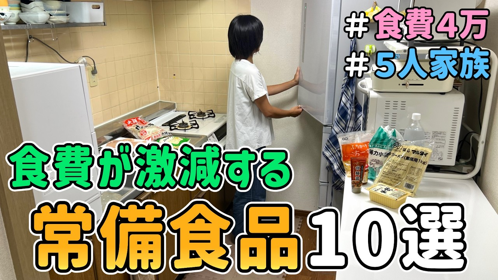

# 【食費の節約】ドケチ主婦が本気で惚れた「常備食品10選」とその活用レシピを紹介した結果｜節約生活/5人家族/貯金/節約レシピ

- 調べた日：2026-10-12（数字はいちばん新しい日の時点）
- チャンネル：リッチじゃない暮らし（@setsuyaku-life、登録者 56,300人）
- 公開日：2026-08-27　長さ：18分30秒　形：横長
- 再生：539,657回（登録者の 9.6倍）　高評価：2,116　コメント：149
- URL：https://www.youtube.com/watch?v=eDHrl_AbF00

## サムネ

## 人気のコメント（いいねの多い順・上から10個）

1. （いいね 57）キラキラに疲れてましたので、派手ではないけど堅実な雰囲気が助かります。 参考にさせて頂きます😊
2. （いいね 30）コーラまで作ってしまうなんて😂やっぱりみさきさんすごい💖
3. （いいね 28）御家族がこんなに褒めてくれたらうれしいですね！やる気アップ！
4. （いいね 21）旦那さん、優しい方ですね。 お子さんもお母さん大好きなのが 伝わってきました。 ちなみにお子さんと同じ年齢の時 この量では足りません（笑） 小学１年生の時、ラーメン屋で、 大きいラーメン２杯と炒飯４人前、 餃子８個食べても余裕なので。 朝からパン１斤を１人で食べます。
5. （いいね 20）コーラって作れるんですね！美味しそう❤
6. （いいね 18）みさきさんのお料理も美味しそうですし、何より美味しそうに食べてくれるお子さんやご主人がとても素敵です🥰 幸せな食卓ですね！
7. （いいね 16）旦那さんの 『気になるね。 動画見てみよう』は、素晴らしい 　うちの旦那は まったく興味なしなので、 素晴らしいです
8. （いいね 15）動画を見ました。 個人的に常備しているのはプライベートブランドの5食入りの袋麺、プライベートブランドの4袋入りのレトルトカレーはコスパ良いし美味。 あとプライベートブランドの小麦粉を買って、すでに千切りしてるキャベツを半分使い、卵1個、ベビースターラーメンを入れて混ぜ、フライパンで焼けば、お好み焼きが作れます(笑) 小麦粉さまさまです(笑) お役に立てますでしょうか？(笑)
9. （いいね 12）お菓子もジュースいつも手作りなんですか？ 夏はかき氷シロップあるからメロンのシロップと炭酸水だとメロンソーダ、これにバニラアイス入れるとクリームソーダになるよ。 いちご味のシロップは牛乳と混ぜるといちごミルクになる。でも糖分には気をつけよう
10. （いいね 9）本当にお料理上手今度～肉味噌つくって見ます…また甜麺醤レシピ宜しくお願いします  いつも本当に最高なディナーです

## メモ（なぜ伸びた？ 視聴者は何を求めている？）

（2026-10-14 記入）
- なぜ伸びた：「ドケチ主婦が本気で惚れた常備食品10選」。家族の暮らし（5人家族）と節約
- 視聴者が求めている：派手でない堅実さ（「キラキラに疲れていたので助かる」）、家族の温かさ
- 使える要素：10選のまとめ形式／キラキラしすぎない正直さ
