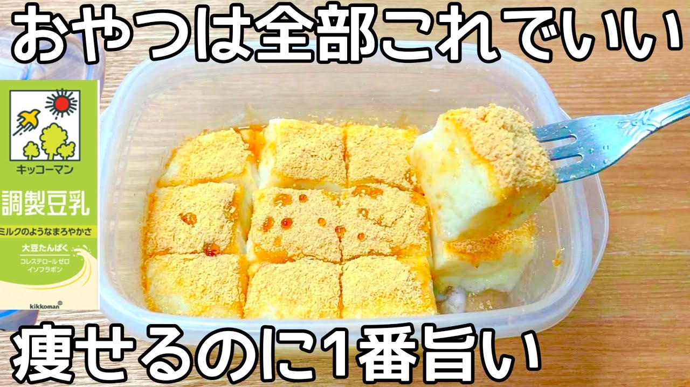

# 5㎏痩せたとき食べてた【材料2つ】【レンチン2分】小麦粉・砂糖不要でダイエット中におすすめのおやつ【豆乳もち】

- 調べた日：2026-10-12（数字はいちばん新しい日の時点）
- チャンネル：夫手取り17万円の節約ごはん（@setuyakugohan、登録者 747,000人）
- 公開日：2026-03-25　長さ：1分29秒　形：横長
- 再生：628,915回（登録者の 0.8倍）　高評価：2,461　コメント：41
- URL：https://www.youtube.com/watch?v=KBvskUr5d4M

## サムネ

## 人気のコメント（いいねの多い順・上から10個）

1. （いいね 22）こんなにウマそ〜なのばっかり作れる奥さんなら最高だなぁ〜😊
2. （いいね 18）まあなんて美味しそうなの(๑´ڡ`๑) コレで今日のおやつは決まりなのです😆✨👍
3. （いいね 15）お家にあるもので、ヘルシーなデザート助かります。ありがとうございます。😊黒蜜かけても美味しそう。
4. （いいね 13）今日はまたまた簡単で美味しそう❤豆乳を買ってきて作ってみます!ありがとうございます🙇
5. （いいね 9）キッコーマンの豆乳シリーズ沢山あるからカロリー気にしなければ色々楽しめそうですね！😊豆腐で作るお餅は良くやりますが、豆乳も美味しそう！！❤
6. （いいね 7）材料二つなら楽
7. （いいね 6）ちょうど調整豆乳と黒蜜があったので、やります！いつも簡単スイーツのご紹介ありがとうございます。お陰さまでお菓子作りなんてしたこともなかった私が、楽しんでお菓子作りに挑戦できています🌼
8. （いいね 6）船橋屋のくず餅を豆乳で代用したらこんな感じになるのかなぁ？ 豆乳の風味が、かえって本家のよりﾔﾐﾂｷになるかも？ 美味しそう🤤
9. （いいね 6）豆乳なくてアーモンド牛乳でも代用出来ますか？
10. （いいね 5）すごい！こんな簡単にできるんだ！ めちゃくちゃ美味しそう…😂 片栗粉 大さじ2：約18〜20gの糖質だから、しっかり糖質摂りたい人におすすめのレシピかなぁ？私はかなり分割して食べないといけなさそう（泣）

## メモ（なぜ伸びた？ 視聴者は何を求めている？）

- 
