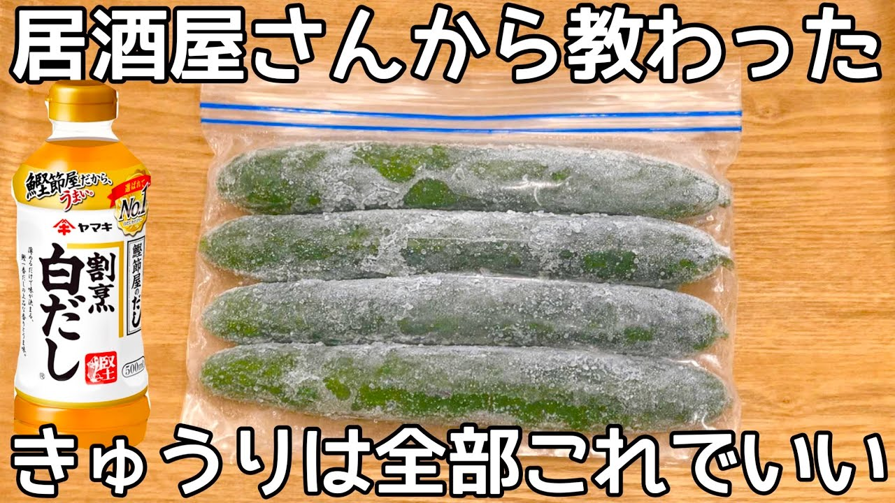

# 凍らせて漬けるだけ【冷凍きゅうり漬け】新食感が病みつき！これからの季節にピッタリ！作り置き・常備菜・大量消費レシピ

- 調べた日：2026-10-12（数字はいちばん新しい日の時点）
- チャンネル：夫手取り17万円の節約ごはん（@setuyakugohan、登録者 747,000人）
- 公開日：2026-04-28　長さ：1分57秒　形：不明
- 再生：2,055,104回（登録者の 2.8倍）　高評価：13,616　コメント：132
- URL：https://www.youtube.com/watch?v=9_5qxtv7J6A

## サムネ

## 人気のコメント（いいねの多い順・上から10個）

1. （いいね 113）🥒きゅうり冷凍出来るの今知りました 染み込みやすいのね…やってみよう
2. （いいね 92）できあがったものはすぐたべないと辛くなっちゃう？？ 作り置きできるのかな？？
3. （いいね 63）漬けるときに輪切り唐辛子と塩昆布をパラパラと入れたくなった。 冷やし中華用にキュウリを買ってきて余らせて「しまった〜」ってなるぐらいなら冷凍しとこ。
4. （いいね 47）今、冷凍庫にキュウリを入れました。 夏はキュウリのお漬物レパートリー、いくつでも欲しいです。 ありがとうございます🌷
5. （いいね 42）確かに　わかめ入ったらよりウマそ😊
6. （いいね 34）なるほど！冷凍で組織壊れるから叩くよりもまんべんなくできるんですね！
7. （いいね 30）にんにくよりおろし生姜を入れたくなりました🤣🤣🤣
8. （いいね 26）塩昆布や鷹の爪入れても美味しそう！！
9. （いいね 24）こんにちは😊  冷凍すると青臭さが無くなるんですね😳 たまに青臭さが気になるキュウリ🥒があってその青臭さがニガテでした😅 これからの季節に嬉しいお漬物ですね😊
10. （いいね 20）一昨日作って見たのですが、皮の繊維感だけが残り、中は水っぽいような感じで、せっかくのきゅうりの食感が失われた漬物になってしまいました🥲 味付けは美味しかったです。

## メモ（なぜ伸びた？ 視聴者は何を求めている？）

- 
