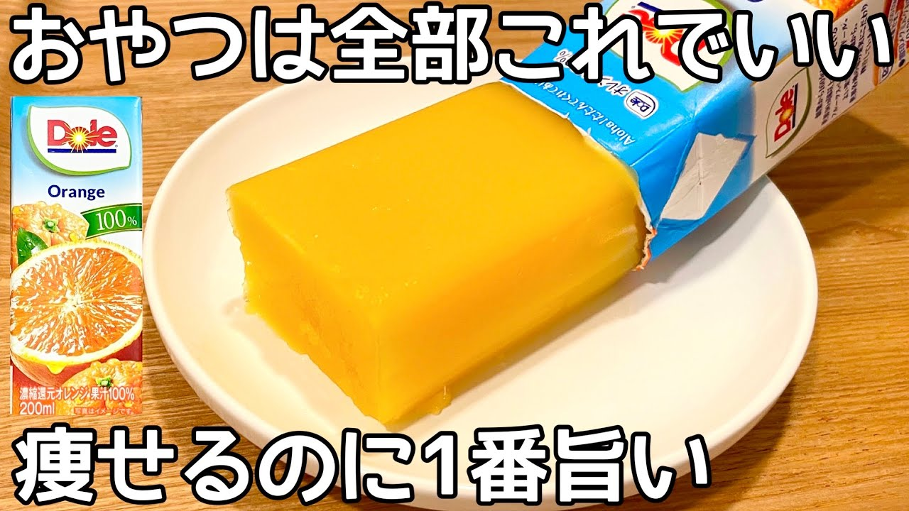

# 混ぜて冷やすだけ【材料2つ】【フルーツゼリー】パックそのまま！砂糖なし！簡単に作れて美味しい♪

- 調べた日：2026-10-12（数字はいちばん新しい日の時点）
- チャンネル：夫手取り17万円の節約ごはん（@setuyakugohan、登録者 747,000人）
- 公開日：2026-05-03　長さ：1分36秒　形：横長
- 再生：623,868回（登録者の 0.8倍）　高評価：5,744　コメント：76
- URL：https://www.youtube.com/watch?v=mBgB2Y-WLg4

## サムネ

## 人気のコメント（いいねの多い順・上から10個）

1. （いいね 535）逆さにして作ると取り出す時ストローの穴から空気入れられて楽チン
2. （いいね 109）ゼラチンはほぼたんぱく質だから、ジュース飲むより健康にいいぐらいだよね。個人的には。牛乳やコーヒー牛乳で作ればいいけど牛乳パックで作ればいいのかな。
3. （いいね 102）原点で頂点みたいなレシピ ありがとう！！！！
4. （いいね 41）夫手取り１７万の節約ごはんさん　おはようございます😃　いつも安くて簡単に作れる料理動画アップありがとうございます😊　早速作ってみたいと思います👩‍🍳🍎🍊
5. （いいね 20）フルーツゼリーがこんな簡単にできて嬉しいです😊これからの季節にピッタリですね😊❤早速作ってみます❤❤
6. （いいね 20）おはよ😊  カンタン過ぎ〰️！ コレ作ってみます！ 凍らしたらもっちりアイスキャンデーかな？
7. （いいね 20）他のジュースでも出来そう❤
8. （いいね 18）いまオレンジジュース高いから、ゼリー買うほうがコスパいいのかな😣でも、果汁沢山入ってるほうが美味しいよね…✨
9. （いいね 18）おはようございます😊 紙パックのフルーツジュースにゼラチン混ぜてゼリーが作れるのは材料が少ない上に洗い物も殆どないのがいいですね👍👌これからの季節にいいデザートだし自分達の好みのフルーツジュースで作れるのもいいですね😊
10. （いいね 17）さっきリンゴジュース買ってきたから早速デザートに作ります❤美味しそうー🎉

## メモ（なぜ伸びた？ 視聴者は何を求めている？）

- 
