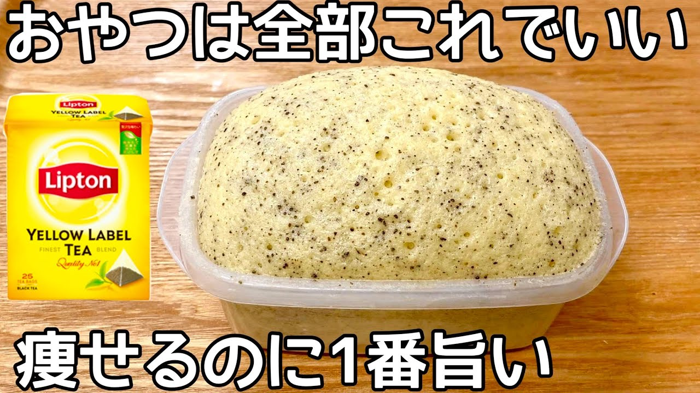

# 5㎏痩せたとき食べてた【レンチン2分半】紅茶パックを入れるだけ！小麦粉・砂糖不要でダイエット中におすすめの紅茶蒸しパン！

- 調べた日：2026-10-12（数字はいちばん新しい日の時点）
- チャンネル：夫手取り17万円の節約ごはん（@setuyakugohan、登録者 747,000人）
- 公開日：2026-06-18　長さ：1分22秒　形：横長
- 再生：1,904,398回（登録者の 2.5倍）　高評価：38,112　コメント：277
- URL：https://www.youtube.com/watch?v=nw4A-DcRMR8

## サムネ

## 人気のコメント（いいねの多い順・上から10個）

1. （いいね 2,155）いきなり始まる、これが良いんです‼️  最初にぺちゃくちゃどうでもいいこと喋って なかなか本題に入らないのが、いっちゃんイヤなので、どうかどうか変わらずこのままのスタイルで宜しくお願い致します🙇
2. （いいね 1,441）ワイはこういう系を作り始め、だんだんと凝るようになり、どんどん太っていった😂
3. （いいね 491）あっと言う間に終わる😂このいさぎよさ😊
4. （いいね 384）作ろう！！て思ってら米粉もベーキングもなかった
5. （いいね 341）米粉の代わりに粉砕したオートミールで作ってみました！！革命！！！！
6. （いいね 262）はかり不要。大さじ・小さじで作れる気軽さが良いですね！休憩時間に作っちゃお😁喫茶店勤務だから材料は色々揃ってます。ちょいちょいマネして作って食べてます。
7. （いいね 159）簡単にできる系本当に前置き長いの多いからありがたい…
8. （いいね 144）このチャンネルはこういうのでいいんだよ、っていう手抜き感があるから好き
9. （いいね 129）材料	量	目安カロリー 卵	1個	約76kcal 豆乳	大さじ2・約30ml	約14kcal 牛乳	大さじ2・約30ml	約18kcal はちみつ	大さじ1・約21g	約69kcal 紅茶パック	1袋・2g	ほぼ0kcal 米粉	大さじ6・約54g	約192kcal ベーキングパウダー	小さじ1	約5kcal  計算すると、  豆乳の場合 76 + 14 + 69 + 0 + 192 + 5 = 約356kcal  牛乳の場合 76 + 18 + 69 + 0 + 192 + 5 = 約361kcal   ざっくりAIに計算させてみた結果です。間違ってたらごめんなさ💦　 ダイエット向きかはさておき、紅茶の蒸しパンが美味しそう！ 作ってみたい°˖✧◝(⁰▿⁰)◜✧˖°
10. （いいね 91）ずっと買うのを躊躇していたベーキングパウダーをついに買うかもしれない

## メモ（なぜ伸びた？ 視聴者は何を求めている？）

- 
