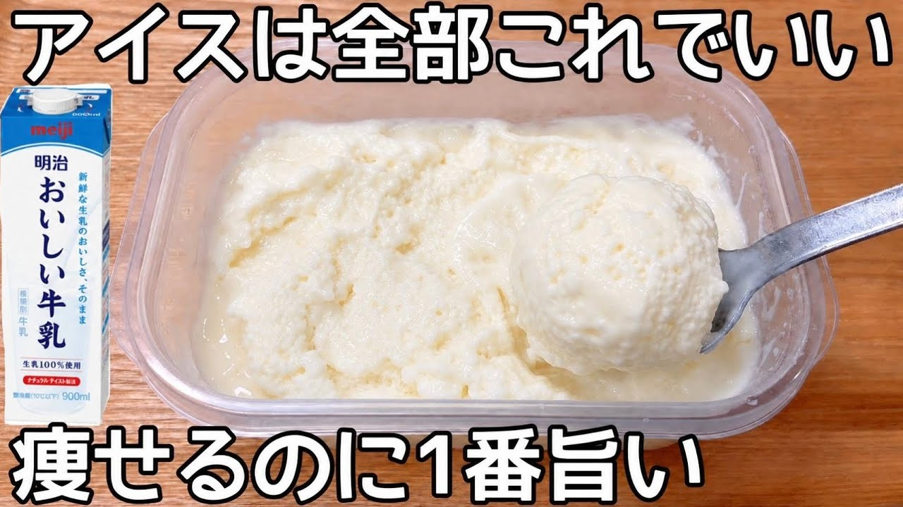

# 卵・砂糖・生クリーム不使用【材料3つ】【濃厚牛乳アイス】レンジで簡単！混ぜてチンして凍らすだけ♪市販のアイスもう買えない

- 調べた日：2026-10-12（数字はいちばん新しい日の時点）
- チャンネル：夫手取り17万円の節約ごはん（@setuyakugohan、登録者 747,000人）
- 公開日：2026-07-01　長さ：1分35秒　形：不明
- 再生：1,194,313回（登録者の 1.6倍）　高評価：27,057　コメント：305
- URL：https://www.youtube.com/watch?v=0Etkofu1WzU

## サムネ

## 人気のコメント（いいねの多い順・上から10個）

1. （いいね 592）卵も砂糖も生クリームも使わないなんて、最初は『本当に固まるの！？』って半信半疑でしたが、作ってみてひっくり返りました！めちゃくちゃ濃厚で美味しいです！材料3つだけでこのクオリティ、もはや魔法…！もう市販のアイスに戻れません！
2. （いいね 376）卵アレルギーの我が子に作ってあげよう！！
3. （いいね 328）めっちゃ美味しかったです❤ 濃厚ミルクアイス🍨って感じです。 作り方ですが、牛乳に米粉を入れると米粉がダマになりやすかったので、米粉に少しずつ牛乳を注いで伸ばしていけばダマになりにくいかなと思いました。
4. （いいね 278）レシピmemo ①牛乳→米粉→はちみつ→バニラエッセンスの順でいれ、よく混ぜる ②軽くふたして600wで3分 ③混ぜて軽くふたして600ｗで2分 ④混ぜて粗熱をとり、冷凍庫で4時間
5. （いいね 248）簡単と言いながら「料理を普段やる人」が枕詞に付くようなチャンネルが多い中、ガチで全く料理できない人でも作れるようなレシピを紹介してくれる神チャンネル
6. （いいね 248）このチャンネル見てるとタッパーもっと買いたくなる
7. （いいね 121）この人、ほんと天才だと思う。 すごい人がいるもんだなぁ。 過去の動画もほんとにすごい。
8. （いいね 117）めっちゃ美味しいかったーーーーーー。味はアイスのやさしい雪見大福味です、米粉が効いてる。神レシピ
9. （いいね 111）これに、粉黒砂糖や紅茶の茶葉をいれたら、また風味が変わりそうです
10. （いいね 74）アイス作りに米粉🍧斬新ですねー🐸

## メモ（なぜ伸びた？ 視聴者は何を求めている？）

- 
