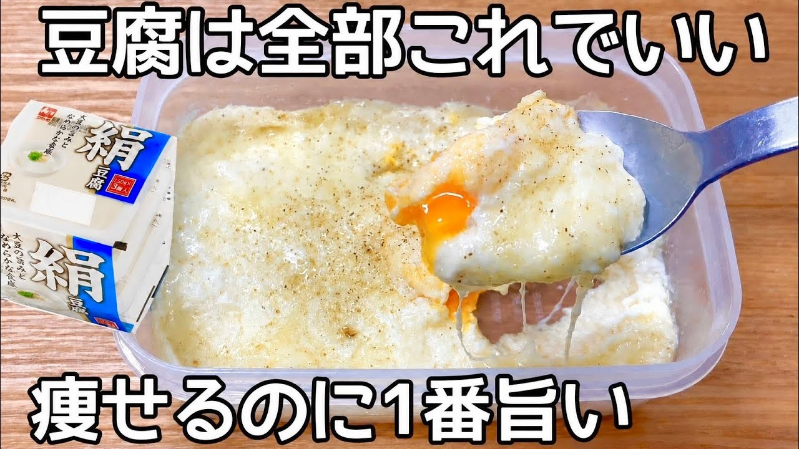

# 5㎏痩せたとき食べてた【レンチン3分】【豆腐グラタン】すぐ出来ちゃう！簡単で病みつき！もう市販のグラタンには戻れません

- 調べた日：2026-10-12（数字はいちばん新しい日の時点）
- チャンネル：夫手取り17万円の節約ごはん（@setuyakugohan、登録者 747,000人）
- 公開日：2026-07-19　長さ：1分39秒　形：横長
- 再生：599,186回（登録者の 0.8倍）　高評価：8,787　コメント：79
- URL：https://www.youtube.com/watch?v=4RJLz_3UCns

## サムネ

## 人気のコメント（いいねの多い順・上から10個）

1. （いいね 79）豆腐ってヘルシーなのに美味しくて何にでも使えるの最高すぎる 大豆のポテンシャルが高すぎるのよね
2. （いいね 50）パンに明太マヨ塗って具としてサンドウィッチにしました。めちゃウマでした！ 感謝！！！
3. （いいね 36）豆腐がホワイトソースの代わりなんですね、鶏むね肉やブロッコリーを入れても良さそうですね😊
4. （いいね 29）おはようございます😊 豆腐グラタン美味しそう😋 私、減量することもなくふつな体型ですが糖質制限をしてるので豆腐やチーズに卵でレンチンして作れるなんて👏チーズ買ってきます。いろいろと参考になるレシピ教えて下さりありがとうございます🙏
5. （いいね 23）これ 何気なく作ったけど 今までの豆腐グラタンの苦手な部分 水っぽさ コクの無さ 分離が 上手くカバーされてて すごく美味しいかったです！ レシピに感謝！ リピ沢山しますね。
6. （いいね 21）やってみようと♫ 豆腐は絹豆腐ですかね？
7. （いいね 12）よし！ダイエットのためにやってみます！ と思ったらコンソメがない！ ほんだしにして、和風グラタンで楽しんでみます(^^)
8. （いいね 12）おはよ😊  なんかいい意味で衝撃的🤩
9. （いいね 10）お仕事が22:30までなので、これはその時間から食べてと罪悪感ないわー❤
10. （いいね 10）作りました！ ホッとする味で美味しかったですー☺️ とろとろが好きなので、1分半チンしてそのまま少し蒸らしました。 内側がアツアツだったので全て混ぜてみると、全体が馴染んで高タンパクなおかゆのような感じで豆腐1パックがスルスルと胃に入っていきました🤭 お夜食にも良さそうですね。 シンプルで作りやすいレシピありがとうございます✨

## メモ（なぜ伸びた？ 視聴者は何を求めている？）

（2026-10-14 記入）
- なぜ伸びた：「5kg痩せたとき食べてた」（体験）＋「レンチン3分」＋「もう市販のグラタンには戻れません」
- 視聴者が求めている：ヘルシーなのにおいしい、豆腐グラタンの苦手（水っぽさ・コクのなさ）が解決されていること
- 使える要素：体験の言葉／その料理の「よくある失敗」を解決していると言う
