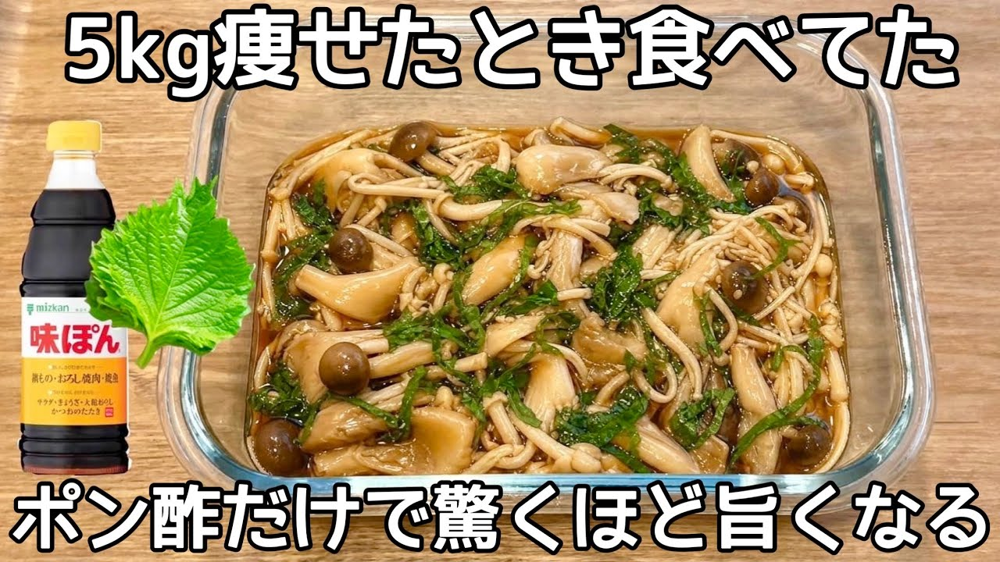

# 【腸活最強】きのこ3種のポン酢漬けが旨すぎる！レンチンして漬けるだけで痩せ常備菜・作り置き・きのこ大量消費レシピ

- 調べた日：2026-10-12（数字はいちばん新しい日の時点）
- チャンネル：夫手取り17万円の節約ごはん（@setuyakugohan、登録者 747,000人）
- 公開日：2026-08-21　長さ：1分39秒　形：横長
- 再生：574,733回（登録者の 0.8倍）　高評価：2,914　コメント：52
- URL：https://www.youtube.com/watch?v=s2Iay7Ieut0

## サムネ

## 人気のコメント（いいねの多い順・上から10個）

1. （いいね 25）ほんと、簡単レシピとかでも挫折してしまう私でも頑張れそうなラインを定期的に紹介してくれて助かってます！！ありがとう！
2. （いいね 13）レンジで簡単調理👍✨🥳
3. （いいね 11）こんなキノコのおかずが簡単に作れるなんて
4. （いいね 9）おはよ😊❤  包丁🔪もまな板も使わず、カンタンに副菜が出来るね👍 きのこ、秋の訪れを感じますね😊
5. （いいね 9）今日作ろう😊
6. （いいね 7）おはようございます(*^^*) 洗い物も少なくエコですね✨ 秋に近づいて、キノコ🍄いいですね〜。秋が楽しみになってきました😊
7. （いいね 5）おはようございます。 簡単きのこだけ鍋、といったﾄｺでしょうか？ まだまだ暑いですが、ひとあし先に秋の味覚ですね✨  出来立ての熱々でいっただっきま～す🍴🙏
8. （いいね 5）おはよ😊❤  包丁🔪もまな板も使わず、カンタンに副菜が出来るね👍 きのこ、秋の訪れを感じますね😊
9. （いいね 4）今作ってみました❤ 凄く美味しくてこれで痩せるならと思いで食べ続けます
10. （いいね 4）キノコ🍄類大好きです❤めっちゃ美味しそうですね😊レンジで簡単にできるのでやってみますね😊❤

## メモ（なぜ伸びた？ 視聴者は何を求めている？）

- 
