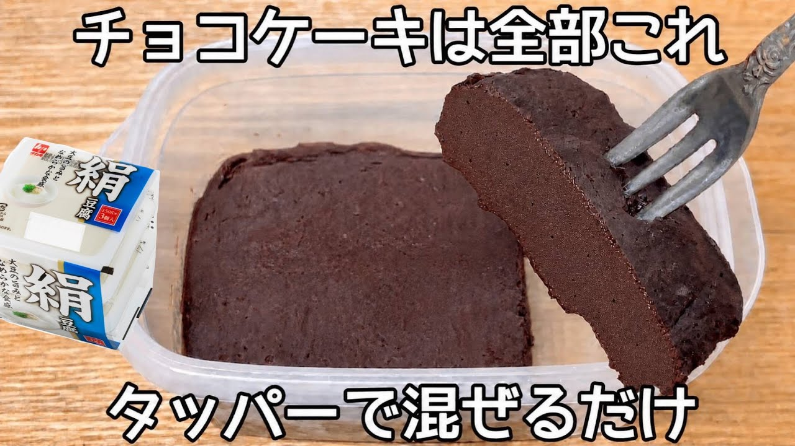

# 材料4つ【豆腐チョコケーキ】混ぜてチンするだけ！ヘルシー高タンパクでおなかも満たされる！

- 調べた日：2026-10-12（数字はいちばん新しい日の時点）
- チャンネル：夫手取り17万円の節約ごはん（@setuyakugohan、登録者 747,000人）
- 公開日：2026-09-18　長さ：1分08秒　形：不明
- 再生：146,827回（登録者の 0.2倍）　高評価：992　コメント：31
- URL：https://www.youtube.com/watch?v=lNnfVEcwUkQ

## サムネ

## 人気のコメント（いいねの多い順・上から10個）

1. （いいね 37）やばい！！材料が全部家にある！！！今！！！
2. （いいね 8）おはよ😊❤  なんかめちゃめちゃしっとりしてそう😋
3. （いいね 7）豆腐スイーツはヘルシー
4. （いいね 5）いつもありがとうごさいます😺💛✨ 作ってみたいです😺🍀
5. （いいね 5）おはようございます めちゃくちゃヘルシーで大好物❤です。
6. （いいね 5）ケーキ🍰ヘルシーで美味しそうですね😊いいですね😊❤作ってみたくなりました❤❤
7. （いいね 4）美味しそ〜❤コーンスターチが要らないからコーンスターチが無い我が家でも作れるのが嬉しい😊作ってみますね🎵
8. （いいね 4）おはようございます。 お豆腐混ぜる事でｼｯﾄﾘ感が増して、ﾒﾁｬﾒﾁｬ美味しそう🤤 作ってみよっと♪
9. （いいね 4）薄力粉で米粉の代用できますか？😢
10. （いいね 4）まあなんて美味しそうなの(๑´ڡ`๑) 作り方も簡単、材料も揃ってるから休みの日にでも作ってみようかしら😆✨👍

## メモ（なぜ伸びた？ 視聴者は何を求めている？）

- 
