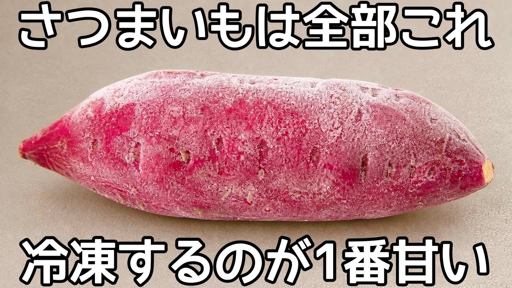

# 普通のさつまいもが甘く美味しくなる裏技！【冷凍さつまいも】包丁もピーラーもいらない！手でちぎるだけの簡単さつまいもスイーツ

- 調べた日：2026-10-12（数字はいちばん新しい日の時点）
- チャンネル：夫手取り17万円の節約ごはん（@setuyakugohan、登録者 747,000人）
- 公開日：2026-09-21　長さ：1分43秒　形：横長
- 再生：769,837回（登録者の 1.0倍）　高評価：2,709　コメント：92
- URL：https://www.youtube.com/watch?v=c9Gd72dPKcw

## サムネ

## 人気のコメント（いいねの多い順・上から10個）

1. （いいね 154）どうやって解凍するんだろう〜って思って見てたらめちゃくちゃ簡単だった。これはすごい。 そして芋をちぎるという何気に衝撃映像でした笑
2. （いいね 130）芋ってちぎれるんや笑
3. （いいね 110）サツマイモを素手で裂く！　中々の光景だったｗ
4. （いいね 63）芋をちぎる😂スペシャルワードですね！！やってみます！！
5. （いいね 37）こういう裏ワザがあるのですね
6. （いいね 37）バニラアイスにトッピングしたくなりました❤️
7. （いいね 35）え？冷凍……？ちぎる………？ !?工エエェ(ﾟ〇ﾟ ;)ェエエ工!? でもちぎるの気持ちよさそうww 今日さつまいも買ってきます🍠
8. （いいね 32）JAなめがたしおさいのブランド「紅優甘」や「行方の黄福」でお試しください 神奈川県民ですけど、この2つは本当に素晴らしい
9. （いいね 25）美味しいに決まってる！台風の中、お出かけ出来ず家ばかりでしたが、さつま芋ならある！！早速冷凍からやります。
10. （いいね 23）｢サツマイモ蒸すな！ ちぎれ！｣が サツマイモの新しいレシピになるかも👍

## メモ（なぜ伸びた？ 視聴者は何を求めている？）

（2026-10-14 記入）
- なぜ伸びた：「普通のさつまいもが甘くなる裏技」「手でちぎるだけ」。芋をちぎる絵がおもしろい。サムネ「さつまいもは全部これ／冷凍するのが1番甘い」
- 視聴者が求めている：簡単さ（包丁もピーラーもいらない）、意外な場面（芋ってちぎれるんや）
- 使える要素：裏技／「手でちぎる」のような目を引く1場面／「〜するのが1番甘い」
