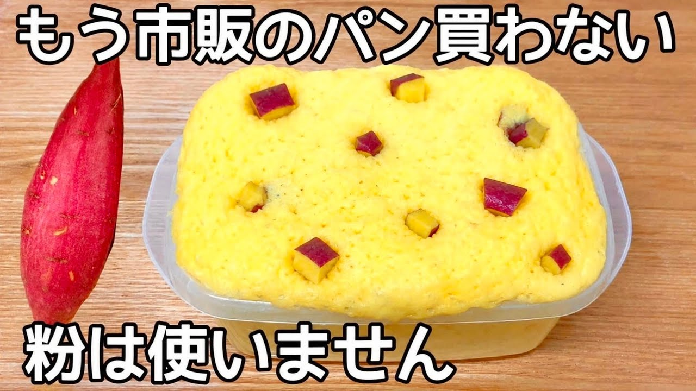

# 小麦粉・米粉・砂糖不使用【さつまいもだけで作れる蒸しパン】レンジで簡単！タッパーで混ぜてチンするだけ♪市販のパンもう買えない

- 調べた日：2026-10-12（数字はいちばん新しい日の時点）
- チャンネル：夫手取り17万円の節約ごはん（@setuyakugohan、登録者 747,000人）
- 公開日：2026-09-29　長さ：1分42秒　形：横長
- 再生：284,336回（登録者の 0.4倍）　高評価：2,413　コメント：84
- URL：https://www.youtube.com/watch?v=Sclqb66S0LE

## サムネ

## 人気のコメント（いいねの多い順・上から10個）

1. （いいね 63）すごい、すごい！！さつまいもの代わりに、カボチャ（4分の1）をレンチンで柔らかくして潰し、後の材料は同様の分量、レンジも500W4分で作ってみました。ほんわり膨らみ、バッチリ美味しく出来ました！粉類が入らないから、時間が経ってもかたくならなさそうですね。
2. （いいね 37）無駄のない動画！ 音楽もなくてよい。 参考になりました！
3. （いいね 34）粉類使用せず、BPでここまでふわふわなのすごい😂
4. （いいね 26）すごい！こういうのって何かしらの粉がないと作れないと思ってた！身体にいいですね✨
5. （いいね 26）おはよ😊❤  粉使わなくても、パンになるんだね😳　 びっくり😳　 さつまいも🍠の優しい味で美味しそう😊
6. （いいね 18）天才！ この時期にぴったりですね！
7. （いいね 12）おやつに良さそうです！ 冷えても形かわらないんでしょうかね……？
8. （いいね 10）めっちゃ美味しそう！さつま芋どっさりあるから早速作ります
9. （いいね 10）はじめまして、美味しいそうです。さつまいも貰ったの沢山あるので作ってみたいです。 豆乳がないのですが、牛乳でも大丈夫でしょうか？
10. （いいね 8）粉なし？😱今日作りますっ😆

## メモ（なぜ伸びた？ 視聴者は何を求めている？）

- 
