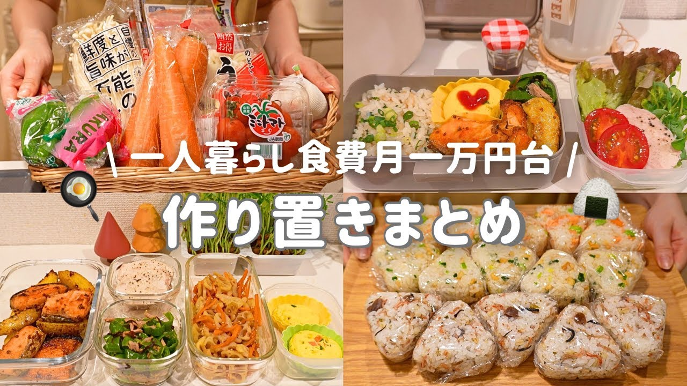

# 【食費月一万円台】平日楽する作り置きストック🧊⌇一人暮らし社会人の自炊記録と節約弁当🥢

- 調べた日：2026-10-12（数字はいちばん新しい日の時点）
- チャンネル：shiroのくらし（@shiro_.312、登録者 96,700人）
- 公開日：2026-10-03　長さ：21分04秒　形：横長
- 再生：357,609回（登録者の 3.7倍）　高評価：1,464　コメント：109
- URL：https://www.youtube.com/watch?v=Sq4NyDHvyHA

## サムネ

## 人気のコメント（いいねの多い順・上から10個）

1. （いいね 17）レシピは自分で考えているのですか〜？💭あとtemuの商品の品質はshiroさん的にいかがでしょうか…？安くて使ってみたいけど品質や販売手法が気になっちゃって😭
2. （いいね 12）作り置きレシピ嬉しいです！ 一人暮らしなので見てると自炊のモチベ上がります🥰
3. （いいね 10）提供：Temu https://app.temu.com/k/gxtmouwdglx 上のリンクからクリックまたはアプリの検索バーで【ket3946】を検索すれば、3,000円分のクーポンをGETできます！Temuの全商品でご利用いただけます！ 送料無料＋90日以内返品無料！ ❋新規ユーザー：3001円以上で3,000円オフ ❋既存ユーザー：最低注文額以上で3,000円オフ リンクをクリックしてからクーポンが24時間以内に有効なので、早めに決済まで使ってみてね。 ご不明な点などがございましたら、Temuサポートチームまでご連絡ください。
4. （いいね 9）作り置き動画好きなんで嬉しい😆
5. （いいね 8）今日の動画も楽しく 見させていただきました 次回も楽しみに待っています
6. （いいね 8）うどんのストックで3種類、味が違って楽しめそうですね！そして美味しそう！作って見ます😊
7. （いいね 8）おはようございます☀ 私も作り置き動画大好きです🥰 チルドうどんは冷凍出来るんですね🥹これ、お家で1人ランチの時にいいなって思いました🍲💕 今週も参考になりました✨ありがとうございます😍
8. （いいね 7）玉子焼き作りました～ ふわふわで美味しい😋
9. （いいね 7）今回もすてきな動画ありがとうございます～😃 うどんｽﾄｯｸとおにぎり🍙ｽﾄｯｸのｱｲﾃﾞｱ、ナイスｱｲﾃﾞｱですね✨✨他のもですがやってみます🙆‍♀️おしえていただき、ありがとうございます😁
10. （いいね 6）うどんアレンジ参考になります！ありがとうございます🎉

## メモ（なぜ伸びた？ 視聴者は何を求めている？）

- 
