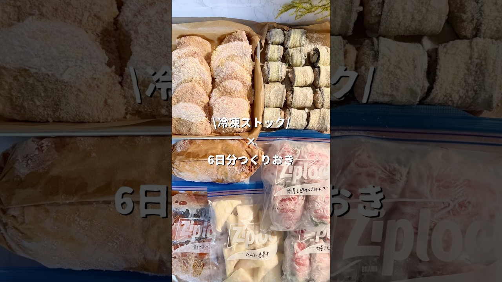

# ＼子どももよろこぶ冷凍ストック6日分／①ハムチーズ春巻き ②肉巻きピーマンポテチー ③しそチーズカツ ④なすつくねロール ⑤鮭ごまみりん ⑥レンチンチーズトマトチキン

- 調べた日：2026-10-12（数字はいちばん新しい日の時点）
- チャンネル：しろ冷凍レシピ（@siro_.recipe、登録者 10,200人）
- 公開日：2026-09-02　長さ：1分17秒　形：ショート（縦長）
- 再生：542,859回（登録者の 53.2倍）　高評価：7,156　コメント：33
- URL：https://www.youtube.com/watch?v=MFBlYsky2Fw

## サムネ

## 人気のコメント（いいねの多い順・上から10個）

1. （いいね 43）メニューも斬新というか、ありきたりな具材のはずなのに食べたことない作り方になってて見ててほえー、って勉強になった。ただこの作り置きを入れるスペースを作らないと始められない→冷凍庫の中身減らそう→使って作って食べて疲れて作り置き作る余裕ない→また買ってそのまま冷凍ストック→使って作って食べて…のループになる自信しかないw
2. （いいね 23）真似したい、、、頑張れる時に😂
3. （いいね 16）見惚れて終わりました。
4. （いいね 11）すごい‼️❤❤❤
5. （いいね 10）ナスが思ったより薄く切れず…。塩水に漬ける時間が短かったからかパキパキで、結局サンドにして焼きました😭
6. （いいね 9）夕飯でもお弁当でも使えるしすごい！
7. （いいね 4）良いですね。  パン粉が、たっぷりで美味しそう。  いっその事、トーストに乗せても良いと想いました。  トマト味やチーズも、茄子とかの御野菜が食べ易いです。  秋ですし、キノコとかも良いですよね。
8. （いいね 3）美味しそう😋すごく、参考になります😆沢山〜レシピ教えてほしい😊😋
9. （いいね 3）すごすぎる😂
10. （いいね 3）チーズだらけ

## メモ（なぜ伸びた？ 視聴者は何を求めている？）

- 
