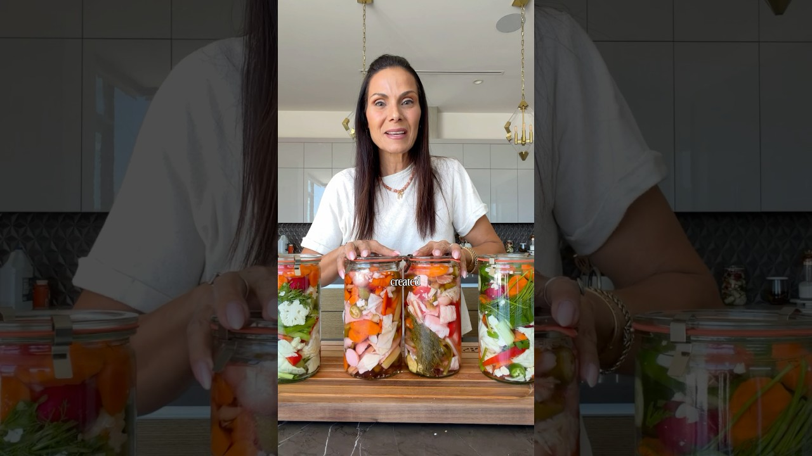

# 2-day veggie pickle trick✨ full recipe  pinned in comments. #pickle #easy #nofuss  #easyrecipe

- 調べた日：2026-10-12（数字はいちばん新しい日の時点）
- チャンネル：Sivan's Kitchen（@sivanskitchenla、登録者 650,000人）
- 公開日：2026-08-04　長さ：1分59秒　形：ショート（縦長）
- 再生：2,672,889回（登録者の 4.1倍）　高評価：126,073　コメント：1,637
- URL：https://www.youtube.com/watch?v=u3Ic6TITVX8

## サムネ

## 人気のコメント（いいねの多い順・上から10個）

1. （いいね 10,274）Most ppl don't toss out the vegetables or make pickles . They just stop buying  the same veggies before using the old ones out .
2. （いいね 3,512）Because of YOU my refrigerator is now full of pickles and my family is full of smiles❤ love you so much🎉
3. （いいね 1,291）Protect this woman at all cost!! Sivan you’re a gem ✨
4. （いいね 729）Stop 🛑 throwing out perfectly good veggies, do this instead 👇🥒✨ Link to my jars can be found in my bio in my amazon storefront ❤  If you’re anything like me, you buy fresh veggies… then discover perfectly good ones still hiding in the fridge drawer. Instead of tossing them, I turn everything into the easiest homemade pickles and honestly, my family devours them every single time.  Just a few minutes, one, two, or three jars, and in a couple of days you’ve got the most delicious crunchy snack waiting for you. I promise this will become a regular in your home too 💛  How to make them: • Any vegetables you have, cut up • Add to a 1 L jar • 2 tbsp kosher salt • ½ cup white distilled vinegar • Fill the rest with filtered water  Leave the jar on your counter for 2 days, then they’re ready to eat. I like to move mine to the refrigerator after that to keep them nice, cold, and crisp. They can last for months in the fridge… but realistically? Not a chance 😉  Prefer salt-only pickles? Skip the vinegar and add an extra ½ tbsp salt.  #sivanskitchen #nofoodwaste #pickles #easy #homemade
5. （いいね 548）“Even recycled jars” 😂😂 girl, 95% of my jars are recycled jars! Love this! Will try this recipe this week, thank you
6. （いいね 425）I love your style of content, how direct and straight to the point you are. You are so intentional with everything you do! Thank you 🙏🏻
7. （いいね 371）You’re such a cool mom and grandma i love your cooking so much it’s so simple , love from Saudi Arabia ❤
8. （いいね 219）Listen to that crunch
9. （いいね 212）Woman those « old » vegetables look very fresh and new
10. （いいね 167）Sivan, Your parents loved and educated you.  Thank you for sharing your knowledge on Youtube.

## メモ（なぜ伸びた？ 視聴者は何を求めている？）

- 
